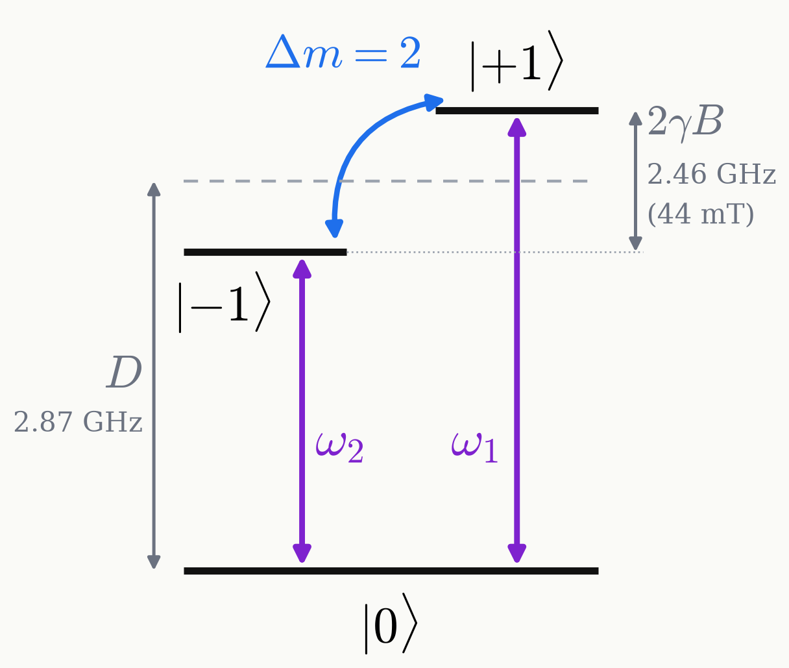

# Intro Double-quantum transition

Two frequency components drive the $\Delta m=2$ transition between $\ket{{+1}}$ and $\ket{{-1}}$.

<figure class="figure">

</figure>

| | superposition | phase after $t$ |
|---|---|---|
| single quantum | $\ket{0}+\ket{{+1}}$ | $\gamma Bt$ |
| double quantum | $\ket{{-1}}+\ket{{+1}}$ | $2\gamma Bt$ |

- One frequency component drives each transition $0\leftrightarrow\pm1$.
- The $\pm1$ superposition picks up twice the phase per unit field.
- Twice the phase doubles the magnetometric sensitivity.

Mamin et al., PRL 113, 030803 (2014)

<!--
The double-quantum transition.

The NV ground state is an electron spin S = 1 with zero-field splitting D = 2.87 GHz. A static field B along the NV axis splits m_s = +1 and -1 by 2 gamma B. In our set-up B = 44 mT (440 G), so 2 gamma B = 2.46 GHz and the two transitions sit at D - gamma B = 1.64 GHz and D + gamma B = 4.10 GHz. The diagram is not to scale.

We apply one microwave field with two frequency components: omega_1 on the 0 <-> +1 transition and omega_2 on the 0 <-> -1 transition. Together they move the spin directly between +1 and -1: Delta m = 2, hence "double quantum" (DQ).

Why bother: a superposition of +1 and -1 picks up the field-dependent phase of both levels, 2 gamma B t, while a single-quantum superposition of 0 and +1 picks up gamma B t (phases written in the frame rotating at D, so only the field-dependent part is shown). Twice the phase per unit field doubles the magnetometric sensitivity (Mamin et al., PRL 113, 030803 (2014)).
-->
