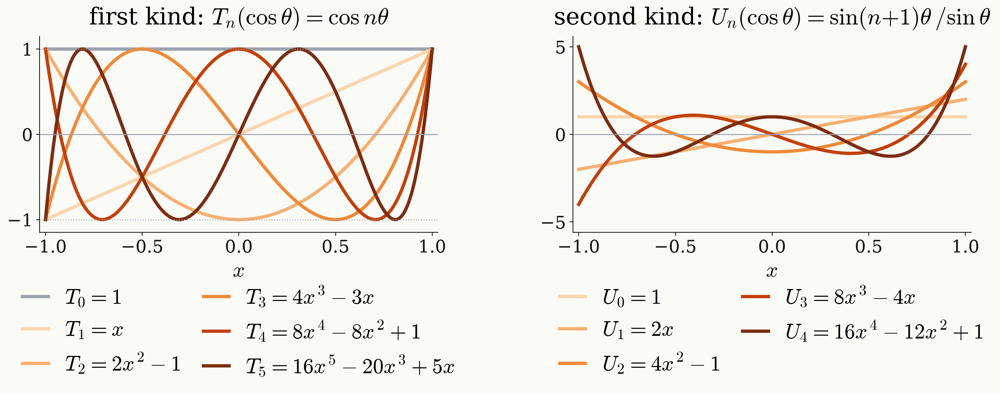

# Method Chebyshev polynomials

<figure class="figure">

</figure>

$$
T_{n+1}=2x\,T_n-T_{n-1}\quad(\text{same for }U)\ \Longleftarrow\ \cos(n{+}1)\theta+\cos(n{-}1)\theta=2\cos\theta\cos n\theta
$$

<!--
These are the polynomials that carry the rest of the talk.

Left, the first kind: T_n(cos theta) = cos(n theta). T_0 = 1, T_1 = x, T_2 = 2x^2 - 1, up to T_5 = 16x^5 - 20x^3 + 5x. They all stay between -1 and +1 on [-1, 1], and T_n touches +1 and -1 alternately at n + 1 points.

Right, the second kind: U_n(cos theta) = sin((n+1) theta) / sin theta. U_0 = 1, U_1 = 2x, up to U_4 = 16x^4 - 12x^2 + 1. They grow at the ends, up to n + 1 at x = +-1, because of the division by sin theta. The colours pair U_{n-1} with T_n: they are the imaginary and the real part of the same z^{-n}.

Why they are polynomials: the identity cos(n+1)theta + cos(n-1)theta = 2 cos(theta) cos(n theta) gives the recurrence T_{n+1} = 2x T_n - T_{n-1}, and the same recurrence holds for U. Starting from T_0 = 1 and T_1 = x, every T_n is a polynomial of degree n.

The physical reading of the recurrence: multiplying by x = cos theta moves harmonic n to n + 1 and n - 1. That is what one wait does to an amplitude. So each wait raises the degree by one.

One identity we use later: T_n^2 + (1 - x^2) U_{n-1}^2 = 1, which is cos^2 + sin^2 = 1, the unitarity of the pulse-free sequence.
-->
