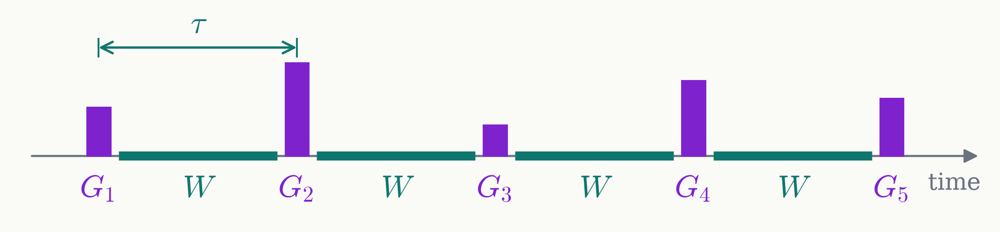

# Method Signal and processing

The waits carry the signal; the pulses process it.

<figure class="figure">

</figure>

$$
u=G_N\,W\,G_{N-1}\cdots W\,G_1=\begin{pmatrix}P&-Q^*\\ Q&P^*\end{pmatrix},\qquad
W=R_z(\Delta\tau)=\begin{pmatrix}z^{-1}&0\\ 0&z\end{pmatrix},\qquad z=e^{i\theta},\ \ \theta=\tfrac{\Delta\tau}{2}
$$

- Only the waits depend on $\Delta$: each multiplies an amplitude by $z^{-1}$ or $z$.
- The pulses $G_k$ are instantaneous rotations about any axis in the $xy$ plane.
- $P$ and $Q$ have degree $K=N-1$, the number of waits.

<!--
In general the pulses need not be about x. A quantum signal processing sequence: N instantaneous pulses G_1 to G_N, separated by K = N - 1 equal waits of length tau. Drawn here with N = 5 pulses and K = 4 waits; the bar heights stand for different pulse angles, and each pulse can also have its own phase, that is its own axis in the xy plane.

Time runs left to right, the operator product right to left: u = G_N W G_{N-1} ... W G_1.

The detuning enters only through the waits, W = R_z(Delta tau) = diag(z^{-1}, z) with z = e^{i theta}. That is the signal. The pulses are fixed rotations that do not depend on Delta; their angles and phases are the processing we design.

Every wait multiplies an amplitude by z^{-1} or by z, and the pulses only mix the two amplitudes with constant coefficients. So the entries of u are polynomials in z and z^{-1} of degree K, the number of waits, with only the powers of the parity of K: z^{-K}, z^{-K+2}, ..., z^{K}.

We write u in the standard SU(2) form with P on the diagonal and Q off the diagonal: P is the amplitude to stay, Q the amplitude to flip. This is the same pair as in Part I, where the DQ pi pulse is P = 0.
-->
