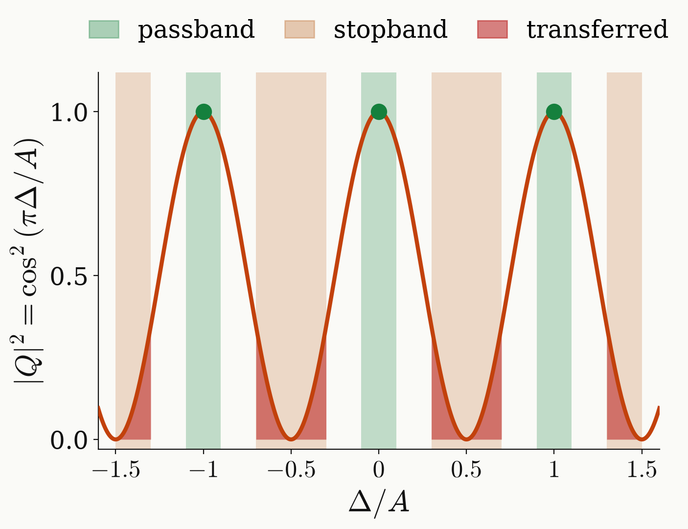

<!-- _class: tight -->

# Method Simple targets

Two simple targets need only one or two pulses.

- **Passband only:** $r\equiv1=T_0$, $K=0$. One $R_x(\pi)$ gives $P=0$, $Q=-i$ at every $\Delta$.
- **Exact at the three resonances**, $\tau=2\pi/A$: $x_m=\cos m\pi=(-1,1,-1)$, so $r=x=T_1$, $K=1$:

$$
R_x(\tfrac{\pi}{2})\,W\,R_x(\tfrac{\pi}{2}):\qquad P=-i\sin\tfrac{\Delta\tau}{2}=0,\quad Q=-i\cos\tfrac{\Delta\tau}{2}=\mp i\quad\text{at every }\Delta=nA.
$$

<figure class="figure">

<video src="media/resonances-to-x.mp4" poster="media/resonances-to-x.png" width="520" controls autoplay loop muted playsinline preload="none"></video>

</figure>

<figure class="figure">

</figure>

- Neither design protects the stopband: the second transfers up to $0.35$ of the population there.

<!--
Two targets are easy, and they show what the hard one asks for.

Passband only, no stopband: with instantaneous pulses the target is the constant r ≡ ±1 = T_0, degree zero. One π pulse R_x(π) gives P = 0 and Q = −i at every detuning, exactly. Any further pulses in a design of this kind only serve to cancel the detuning dependence of the real, finite pulse.

Exact at the three resonances only, Δ = 0 and ±A, with τ = 2π/A: then θ = Δτ/2 = πΔ/A, so θ_m = mπ and x_m = cos θ_m = (−1, 1, −1). The clip shows it: the three resonances move round the circle z = e^{iθ}; the central one stays at x = 1, the outer two both land on x = −1. With the signs (−, +, −) the conditions are r(1) = +1 and r(−1) = −1, and the straight line r = x = T_1 goes through both: degree K = 1, two pulses. Completing it gives the Ramsey-type sequence R_x(π/2) W R_x(π/2), with P = −i sin(Δτ/2) and Q = −i cos(Δτ/2): P = 0 and Q = ∓i at every Δ = nA.

The figure on the right is |Q|² = cos²(πΔ/A) of that sequence. It inverts at every resonance, but in the stopband it transfers up to cos²(0.3π) = 0.35, and it is zero only at the single points ±0.5A and ±1.5A. Protecting the whole stopband is what costs pulses.
-->
