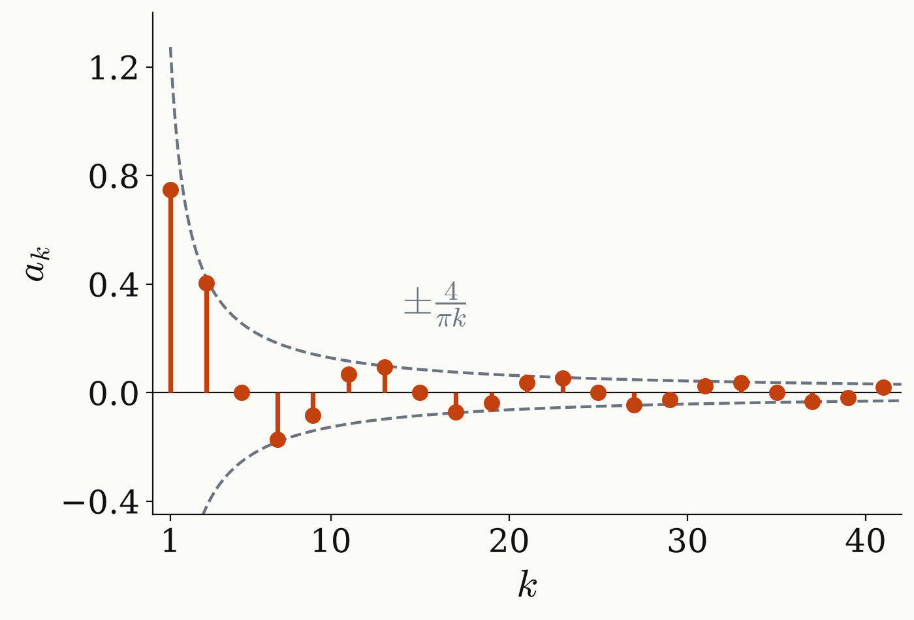

<!-- _class: tight -->

# Method Chebyshev expansion

The target is a Chebyshev series in $x$. Each wait contributes $z^{\pm1}$, so $Q=\sum_k q_k z^k$ is a Laurent polynomial. Its harmonics pair into Chebyshev polynomials:

$$
z^{\pm k}=T_k(x)\pm i\sin\theta\,U_{k-1}(x),\qquad x=\cos\theta .
$$

The target $Q_t=-i\,r(\theta)$ is even in $\Delta$, so $q_k=q_{-k}$ and only cosines survive:

$$
r(\theta)=\sum_k a_k\cos k\theta=\sum_k a_k\,T_k(x).
$$

At $\tau=2\pi/A$ the step with its jumps mid-band has

$$
a_k=\frac{4\sin(0.2\pi k)}{\pi k},\qquad k \text{ odd}.
$$

<figure class="figure">

</figure>

<!--
Two coordinates for the same function. In the Z basis every wait multiplies each path by z or z^{−1}, z = e^{iθ}, θ = Δτ/2, so Q is a Laurent polynomial in z of degree K with K + 1 coefficients. Since z^k + z^{−k} = 2 cos kθ = 2 T_k(x) and z^k − z^{−k} = 2i sin kθ = 2i sin θ U_{k−1}(x), the Laurent coefficients regroup into Chebyshev polynomials in x = cos θ: the same K + 1 numbers, a change of basis.

The target is symmetric in the detuning: Q_t = −i r(θ) with r even, so q_k = q_{−k}. Then Σ q_k z^k = q_0 + Σ_{k>0} q_k (z^k + z^{−k}) = q_0 + Σ_{k>0} 2 q_k T_k(x): only cosines, a Chebyshev series in x.

At τ = 2π/A, θ = πΔ/A, and the target lives on x ∈ [−1, 1]: the central window at x ≥ 0.951 (θ ≤ 0.1π), the outer windows both at x ≤ −0.951, the stopband at |x| ≤ 0.588. With the signs (−, +, −) the step is +1 near x = 1, 0 in the middle, −1 near x = −1, with the jumps in the middle of the transition bands, θ = 0.2π from the windows (x = ±0.809). Its Fourier cosine coefficients are a_k = (2/π) ∫ r(θ) cos kθ dθ = 4 sin(0.2πk)/(πk) for odd k, and zero for even k. With the signs (+, +, +) the same formula holds for the even k, with a_0 = 0.4.

The figure shows the a_k: they fall only like 1/k (dashed envelope 4/(πk)), because the step has jumps. That is also why simply cutting this series after degree K does not work: next to each jump the cut series overshoots by about 9 % at every K (the Gibbs phenomenon), so after scaling it to |r| ≤ 1 the error stays near E ≈ 0.2 however many pulses we use. The series insists on reproducing the jump, which the target never asked for; a good polynomial uses the free transition bands instead, and that is the next slide.
-->
