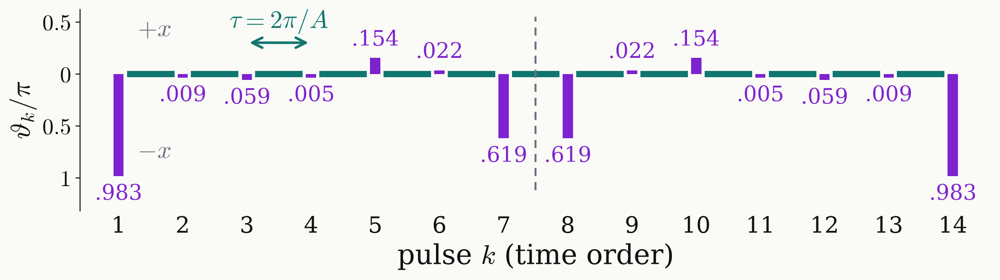
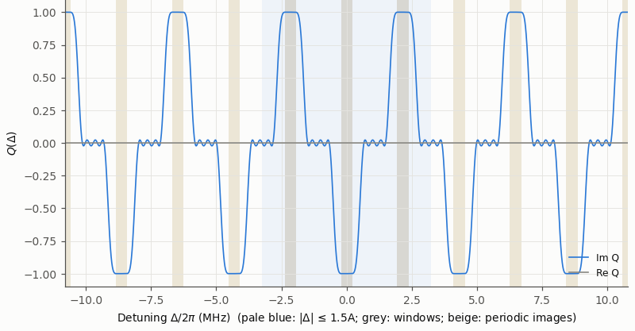

<!-- _class: dense -->

# Results Pulse sequence ($N=14$)

The best polynomial gives fourteen pulses that invert at every $\Delta=nA$: $\ r\xrightarrow{\lvert P\rvert^2=1-r^2}(P,Q)\xrightarrow{\text{strip pulse and wait}}\vartheta_1,\dots,\vartheta_{14}$.

<figure class="figure">

</figure>

<figure class="figure">

</figure>

$$
Q^2(\Delta+A)=Q^2(\Delta)
$$

- The sequence is palindromic, about $\pm x$.
- It inverts at every $\Delta=nA$ and leaves the state unchanged in between.
- Free evolution $K\tau=6019$ ns, $E=5.2\times10^{-4}$.

<!--
From the best polynomial to the pulses. First the completion: 1 - r^2 is non-negative on the whole circle, so by the Fejér–Riesz theorem it is the squared modulus of a polynomial P of the same degree. That gives the full pair P, Q. Then layer stripping: the highest power of z in the pair is produced only by the last pulse, so its top coefficients fix that pulse; multiply it off together with one wait, and the degree drops by one. Repeat 13 times and the 14 angles come out.

The top panel is the result, drawn in time order: N = 14 pulses, K = 13 waits. Bar height is the rotation angle in units of pi; up is a rotation about +x, down about -x; teal are the 13 free evolutions of tau = 2 pi / A = 463 ns. Nearly pi rotations at both ends, 0.983 pi; small rotations next to them; two 0.619 pi rotations in the middle. The sequence reads the same forwards and backwards: palindromic, which is the symmetry of the next slide.

Bottom: Q of this sequence over |Delta| <= 5A. Because Q^2 repeats every 2 pi / tau = A, the sequence inverts at every Delta = nA, including the images at 2A to 5A outside the protected range, and leaves the state unchanged in between. Inside 1.5A, the pale blue region, that is exactly the target.

Its error is 5.2e-4, slightly above the best value 5.1e-4, because the completion keeps a small margin below |Q| = 1. Free evolution 13 tau = 6019 ns.
-->
