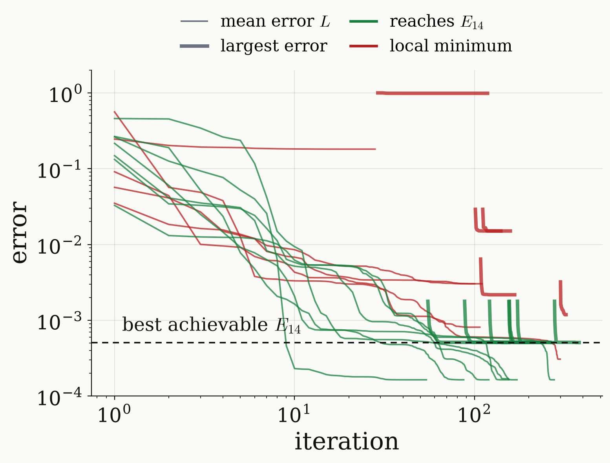

<!-- _class: dense -->

# Results Loss function

Training on the mean error, then on the largest error, reaches the best achievable error.

$$
L=\frac1M\Big[\underbrace{M_{\rm pass}-\frac12\Big(\sum_{j\in\rm pass}\lvert Q_j\rvert^2+\Big\lvert\sum_{j\in\rm pass}Q_j^2\Big\rvert\Big)}_{\min_\chi\ \sum_{\rm pass}\varepsilon_j}+\underbrace{\sum_{j\in\rm stop}\lvert Q_j\rvert^2}_{\text{population transferred}}\Big]
$$

$$
\varepsilon_{\rm pass}=\underbrace{\lvert P\rvert^2}_{\text{not transferred}}+\underbrace{\big[\mathrm{Im}(e^{-i\chi}Q)\big]^2}_{\text{phase error}}
$$

- The common phase $\chi$ is optimised in closed form, so only $Q_j^2$ enters.
- Stage 1 minimises the mean $L$ (exact gradient); stage 2 the largest error.
- At $N=14$, 7 of 12 random starts reach $E_{14}$; symmetric and arbitrary sequences reach $E_N$ for every $N\ge3$.

<figure class="figure">

</figure>

<!--
A real pulse has no polynomial description, so in practice the sequence is trained directly against the target. The loss is the mean error over a grid of M detunings: 30 points in each passband window and 40 in each stopband interval; M_pass of them are in the passband.

Term by term. In the passband the operation we want is Q = ±e^{i chi}: full transfer with one common phase chi. The error at one detuning is 1 - [Re(e^{-i chi} Q)]^2. Because |P|^2 + |Q|^2 = 1, this splits into |P|^2, the population that was not transferred, plus [Im(e^{-i chi} Q)]^2, the part of Q with the wrong phase. In the stopband the operation is the identity, and the error is |Q|^2, the population that was transferred although it should not be.

The common phase chi is free: shifting every pulse phase multiplies Q by a phase. So we minimise over chi in closed form. Using [Re(e^{-i chi} Q)]^2 = (|Q|^2 + Re(e^{-2 i chi} Q^2))/2, the sum over the passband is smallest when e^{-2 i chi} lines up with the sum of the Q_j^2, and that gives the modulus |sum Q_j^2|. Only Q_j^2 appears, so the signs s_m need not be chosen.

Parameters: a symmetric sequence is fixed by the first half of its angles, ceil(N/2) of them, the sign choosing +x or -x; an arbitrary sequence has an angle and a phase for every pulse, 2N parameters. The gradient is exact: u is a product of 2x2 matrices, and one forward and one backward pass give the derivative with respect to every pulse.

Two stages. Stage 1 minimises the mean L with a quasi-Newton method from 12 random starting points (also from the sequence obtained from the polynomial for arbitrary sequences, and from a fit to the best polynomial for symmetric ones). The mean optimum spreads the error unevenly, so stage 2 minimises the largest error over the grid directly, with the common phase fixed; finally E is evaluated on a dense grid.

The figure: all 12 random starts at N = 14, symmetric. Thin lines are the mean error L during stage 1, thick lines the largest error so far during stage 2. Stage 1 takes L from 0.03–0.6 down to 1.6e-4, but the largest error is still about 1.8e-3; stage 2 trades mean for maximum and brings the largest error to 5.1e-4, the best achievable value, dashed, now equioscillating. Green runs reach it within 1 %: 7 of 12. Red runs stop in local minima, one with no inversion at all. Arbitrary sequences behave the same, 6 of 12, about seven times slower per run. The landscape of symmetric QSP is known to have many local minima (Wang, Dong and Lin 2022), which is why one uses several starts or a good one; from the polynomial's sequence or the fit, training converges in about 30 iterations.

Over all N: from N = 3 on, the best trained symmetric and arbitrary sequences sit on the best achievable error; at N = 14 both reach 5.15e-4. At N = 2 training stops at 0.35 instead of 0.28: two pulses give Q = -i sin(theta) cos(theta), the mean error is lowest at a pi/2 rotation, and there the stage-2 step cannot move.
-->
