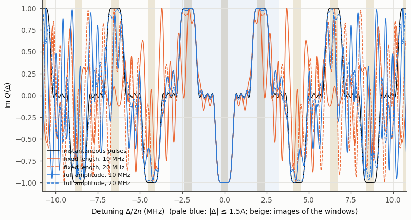

<!-- _class: dense -->

# Results Finite pulses, not retrained

Played with real pulses, the $N=14$ design loses its accuracy.

<figure class="figure">

</figure>

| $N=14$, not retrained | $E$ |
|---|---|
| instantaneous | $5.1\times10^{-4}$ |
| full amplitude, 20 MHz | $8.0\times10^{-3}$ |
| full amplitude, 10 MHz | $7.9\times10^{-2}$ |
| fixed length, 20 MHz | $0.17$ |
| fixed length, 10 MHz | $1.0$ |

- The response is no longer periodic.
- Images far away are suppressed.
- Inside $1.5A$ the pulses distort.

<!--
What happens if we simply play the trained N = 14 instantaneous design with real pulses, with the free evolutions shortened as on the previous slide, and do not retrain?

Two pulse conventions. Fixed length: every pulse lasts t_p = 2 pi / Omega_max, 141 ns at 10 MHz and 71 ns at 20 MHz, and the angle is set by the amplitude. Full amplitude: every pulse is driven at Omega_max and lasts only as long as its angle requires.

The errors: 8.0e-3 with full-amplitude pulses at 20 MHz, 7.9e-2 at 10 MHz, 0.17 with fixed-length pulses at 20 MHz, and 1.0 at 10 MHz, where a window is no longer inverted at all. Shortening the free evolution helps in three of the four cases, for example 8.0e-3 instead of 3.2e-2 at 20 MHz with full amplitude.

The figure shows Im Q over |Delta| <= 5A, the black curve the instantaneous design. Three effects. The response is no longer periodic. The images of the windows are reduced, the more so the weaker the pulses: |Q| at 4A is 0.89 for full amplitude at 20 MHz, 0.25 at 10 MHz, and 0.05 for fixed-length pulses at 20 MHz. And inside 1.5A the distortion destroys the flat inversion and the flat stopband. So a finite-pulse sequence must be retrained.
-->
