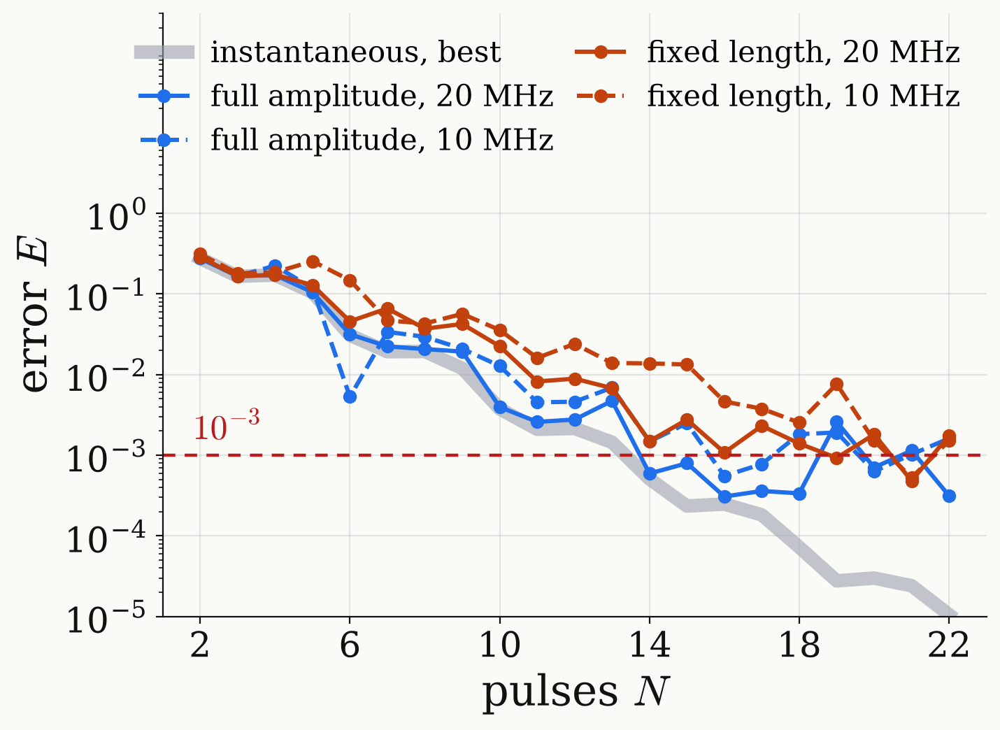

<!-- _class: dense -->

# Results Retraining

Retrained at full amplitude, real pulses cost 0 to 2 extra pulses. Smallest $N$ with $E\le10^{-3}$ (total duration):

| pulses | $\Omega/2\pi$ | symmetric | arbitrary |
|---|---|---|---|
| instantaneous | | 14 (6.0 $\mu$s) | 14 |
| full amplitude | 20 MHz | 14 (5.9 $\mu$s) | 14 (5.9 $\mu$s) |
| full amplitude | 10 MHz | 16 (6.7 $\mu$s) | 15 (6.4 $\mu$s) |
| fixed length | 20 MHz | 19 (7.8 $\mu$s) | $>18$ |
| fixed length | 10 MHz | 21 (9.6 $\mu$s) | $>18$ |

- At fixed length a small angle is a weak pulse.
- Extra pulses per period: $5.2\times10^{-4}$ in $5.9\,\mu\text{s}$ at $10\,\text{MHz}$.

<figure class="figure">

</figure>

<!--
Now retrain: the same loss and the same two stages, with the pulse angles and also the K = N - 1 free evolutions between the pulses as parameters, kept palindromic for symmetric sequences. Starting points: the trained instantaneous design with shortened free evolution; a continuation in the Rabi frequency, training at 160 MHz where the pulses are nearly instantaneous and stepping down to 10 MHz; and a few random starts.

The table gives the smallest number of pulses N that meets the tolerance and the total duration. With full-amplitude pulses at 20 MHz, 14 pulses suffice, as with instantaneous pulses: 5.9e-4 symmetric, 9.4e-4 arbitrary, 5.9 microseconds. At 10 MHz it takes 15 (arbitrary, 6.4 microseconds) or 16 pulses (symmetric, 6.7 microseconds). So full-amplitude real pulses cost 0 to 2 extra pulses. Fixed-length pulses are much harder: 19 at 20 MHz and 21 at 10 MHz, and no arbitrary sequence up to 18 pulses.

Why fixed length is hard: a fixed-length pulse with a small angle is a weak pulse, Omega_k = a_k Omega_max, so |Delta|/Omega_k is large and the distortion strong; a full-amplitude pulse is always driven at Omega_max and lasts only as long as its angle requires. Unlike with instantaneous pulses, arbitrary phases sometimes help: 15 instead of 16 at 10 MHz.

The figure shows the error of the retrained symmetric sequences as a function of N against the best achievable error with instantaneous pulses, grey. The curves are not monotone because training is a local search from a few starting points: they are upper bounds on what N real pulses can do.

One more trick: put one or two extra pulses into every period, spacing pi/A or 2 pi/3A, and retrain everything. At 10 MHz with full-amplitude pulses this gives 5.2e-4 in 5.9 microseconds; with fixed-length pulses 7.7e-4 in 5.8 microseconds and 2.6e-4 in 6.4 microseconds. These are the shortest 10 MHz designs. With instantaneous pulses the extra pulses would be useless; with real pulses they give the training the freedom to cancel the detuning dependence of the pulses.
-->
