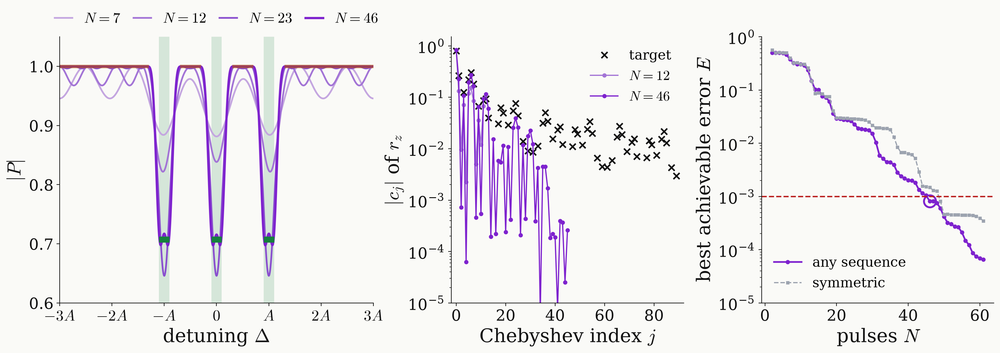

<!-- _class: dense -->

# Results State preparation: Chebyshev expansion

The robust preparation target is a constant, a single Chebyshev coefficient, so it needs no waits; only if $\ket{0}$ must also stay untouched elsewhere in $\lvert\Delta\rvert\le3A$ does it become a step, whose coefficients decay as $1/j$ and whose best approximation needs $N=46$ pulses.

<figure class="figure">

</figure>

<!--
In the polynomial picture the preparation is the easy case. On every window the target is the same pair, P = 1/sqrt2 and Q = -i/sqrt2. A sum of equal steps over the three windows is a constant: degree zero, one coefficient. With instantaneous pulses a single pi/2 pulse is exact at every detuning, and the best achievable error is zero for any number of waits; the same holds for any pulse shape. So the pulses of a robust design are there only to cancel the detuning dependence of the real pulses, and waits, which separate the manifolds, only lengthen the sequence. That is why the shortest robust designs have no waits: 566 ns with fixed-length pulses at 10 MHz against 1324 ns with waits of 2 pi / 3A, and 145 ns at full amplitude.

The target becomes a genuine step only with a stopband: if zero must also be left unchanged at other detunings within 3A, for instance a second NV orientation or a carbon-13 split line, with transition bands of 0.2A. Then |P| must be 1/sqrt2 on the windows and 1 in the stopband. Take tau = 2 pi / 6A, 77 ns, the longest tau whose period covers |Delta| <= 3A without images of the windows.

Left: |P| of the best approximation for N = 7, 12, 23 and 46 pulses, the target green on the windows and amber on the stopband. With 7 pulses the response only sketches the three dips; with 12 and 23 they sharpen; with 46 pulses, 45 waits and 3.47 microseconds of free evolution, the error falls below the tolerance, 8.2e-4.

Middle: the Chebyshev coefficients of r_z = |P|^2 - |Q|^2 in cos(Delta tau). The target's coefficients, crosses, decay only like 1/j, modulated by the array factor 1 + 2 cos(j A tau) of the three windows. The best approximations follow the low coefficients and drop far below the target's at high index: they use the transition bands instead of reproducing the jump.

Right: the best achievable error as a function of N. Up to six pulses it stays near 0.5: a polynomial of such low degree cannot be close to 1/sqrt2 on the windows and to 1 in the stopband at once. Then it falls roughly exponentially and meets 1e-3 at N = 46. Time-symmetric sequences need 49. Any pulse shape needs at least 3.33 microseconds. Robust: hundreds of nanoseconds; with a stopband: microseconds.
-->
