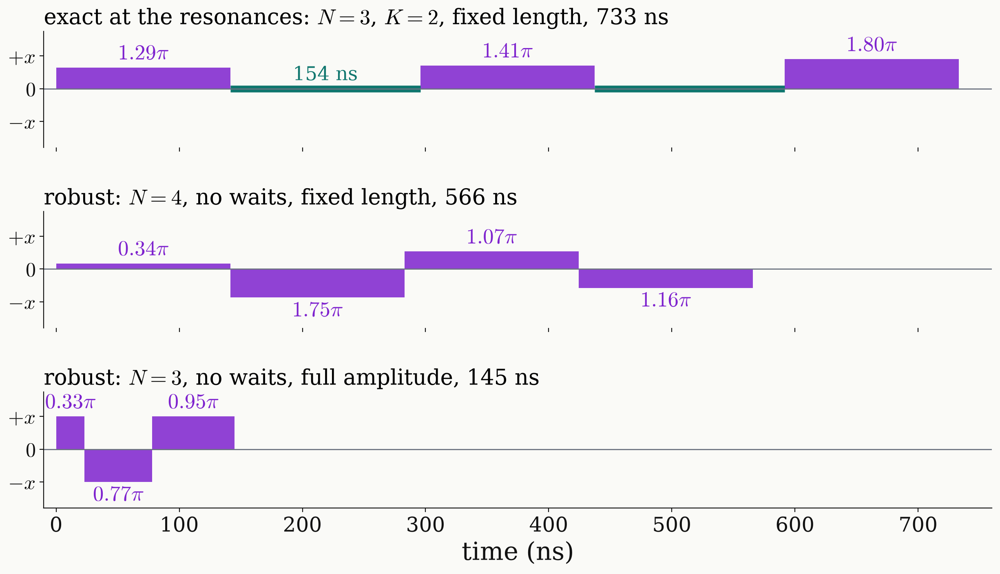

<!-- _class: dense -->

# Results State preparation: pulse sequence

The three preparations at $\Omega/2\pi=10$ MHz are drawn as pulse trains, with the bar height the amplitude relative to $\Omega_{DQ}$, the sign the axis $\pm x$, the width the duration and the number the rotation angle.

<figure class="figure">

</figure>

<!--
Three sequences, all with pulses about plus or minus x, at Omega/2pi = 10 MHz, where Omega_DQ/2pi = 7.07 MHz.

Top, exact at the three resonances: three fixed-length pulses of 141 ns with two waits of 2 pi / 3A, 154 ns: 1.29 pi, 1.41 pi, 1.80 pi, all about plus x, 733 ns. Three pulses because there are three conditions: one real equation at Delta = 0 and two at +A; minus A follows by symmetry. With one pulse fewer, or with a palindromic three-pulse sequence, there is no solution. It is exact at the centres of the windows only. At 20 MHz it takes 521 ns, at the drive of Mamin et al. 405 ns.

Middle, robust over the windows, no waits: four fixed-length pulses, 0.34 pi about x, 1.75 pi about minus x, 1.07 pi about x, 1.16 pi about minus x, 566 ns. This is the design of the clip.

Bottom, robust, no waits, full amplitude: each pulse is driven at the full Rabi frequency and lasts only as long as its angle requires: 0.33 pi, 0.77 pi about minus x, 0.95 pi, 145 ns in total, worst infidelity 2.8e-4 on the windows. At 20 MHz the same kind of design takes 134 ns. A robust preparation thus takes about 0.13 to 0.57 microseconds.
-->
