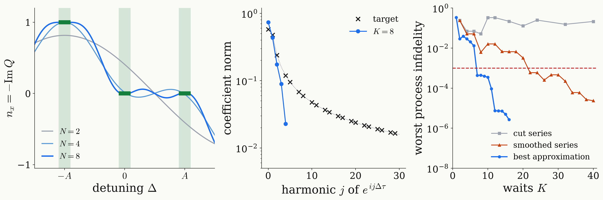

<!-- _class: dense -->

# Results Universal NOT: Laurent expansion

The Laurent coefficients of the universal-NOT target decay only as $3/2\pi\lvert j\rvert$, so the cut series never meets the tolerance; the best approximation meets it with $K=7$ waits ($N=8$ pulses).

<figure class="figure">

</figure>

<!--
How close can QSP get to this step target? With K waits, P and Q are Laurent polynomials of degree K in z = e^{i Delta tau / 2}. Single-frequency qubit, tau = 2 pi / 3A.

Left: one component of the rotation axis, n_x = -Im Q, of the best uniform approximation for N = 2, 4 and 8 pulses; the green bars are the targets in the frame x, y, z on the windows at -A, 0, +A. With two pulses, one harmonic pair, the response passes the targets with steep slopes; with four it reaches them near the centres but slopes across the windows; with eight it is flat on each window and turns in the transition bands.

Middle: the coefficient norms of the target, extended across each gap by a step at the gap centre, in harmonics of e^{i Delta tau}. At this tau the three windows are thirds of the circle, and harmonic j carries the component j mod 3 of the three-point Fourier transform of the window values: zero for j a multiple of 3, otherwise 3 / (2 pi |j|), in every frame. So they decay only like 1/j. The best approximation with K = 8 waits does not follow these coefficients: its constant term is 0.74 instead of 0.58, and it uses the third harmonic, which the step lacks.

Right: the worst process infidelity on the windows as a function of K. The cut series, grey, overshoots at every degree and stays between 0.05 and 0.33: the Gibbs phenomenon. Smoothing the steps with a Gaussian restores convergence, orange, but needs K = 22 waits. The best approximation, blue, is a lower bound for every sequence of K + 1 instantaneous pulses: it falls in steps, 0.34 at K = 1, 3.9e-2 at K = 3, 1.3e-2 at K = 6, then by a factor 30 to 4.3e-4 at K = 7. So no sequence of fewer than 8 instantaneous pulses meets the tolerance, and 8 suffice: a sequence refined from the search reaches 5.8e-4. For any pulse shape the bound gives at least 886 ns. A shorter tau trades waits for time at nearly constant total: 12 waits and 926 ns at 2 pi / 6A, 48 and 889 ns at tau A / 2 pi = 0.04. Tau near pi / A is excluded: two windows coincide modulo the period. The two-frequency DQ qubit needs at least 9 pulses and 905 ns.
-->
