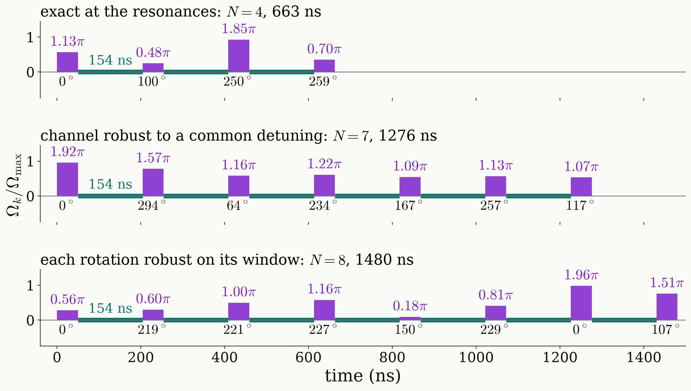

<!-- _class: dense -->

# Results Universal NOT: pulse sequence

Three universal-NOT sequences at $\Omega/2\pi=20$ MHz are drawn as pulse trains: bar height the amplitude, rotation angle above, phase below, waits of $2\pi/3A$ in teal.

<figure class="figure">

</figure>

<!--
Single-frequency qubit, Omega/2pi = 20 MHz is the Rabi frequency of the one microwave field, every pulse 50 ns long with free amplitude and phase, waits of 2 pi / 3A = 154 ns.

Top, exact at the three resonances: four pulses, 663 ns; 1.13 pi at 0 degrees, 0.48 pi at 100, 1.85 pi at 250, 0.70 pi at 259. With finite pulses four are needed: with three the residual stays at 8e-3 to 3.4e-2. At 10 MHz the exact design takes 863 ns, at 40 MHz 563 ns. Exact designs are sensitive to a common detuning: 2.7e-2 at 0.1 MHz.

Bottom, each rotation robust on its window: eight pulses, 1480 ns, the design of the clip. But per-rotation robustness is not the right target for the channel: the process infidelity is second order in an axis error, while the channel's transfer matrix is first order in it, and a field drift detunes all three transitions together. These designs miss the channel by 1.4 to 1.5e-2.

Middle, the channel kept at the universal NOT for every common detuning up to 0.1A: seven pulses, 1276 ns, and 1.3e-4 at a 0.1 MHz detuning. With quasi-static dephasing, T2-star = 1 microsecond: 5.1e-2 for the exact design, 2.7e-4 for this one. No design tolerates a 2 percent amplitude error: 2.1 to 7.4e-2.

Without waits, a composite pulse of 10 pulses at 10 MHz or 20 at 20 MHz takes 1000 ns, 13 percent above the 886 ns bound. The two-frequency DQ qubit needs five pulses for the exact design, 1324 and 971 ns.

With the full nine-level Hamiltonian, checked at 24.1 mT, the exact designs invert every cardinal input with fidelity 0.664 to 0.669, and a second application recovers every input to at least 0.9987; the channel-robust design deviates by 1.1e-3. Four synchronised frequency-selective pi pulses would take 1.6 to 5.5 microseconds and still leave 7.8e-3 to 7.6e-2.
-->
