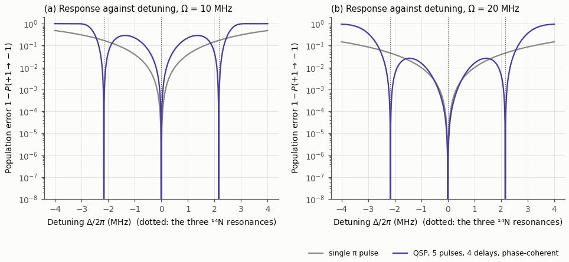

<!-- _class: dense -->

# Backup Exact designs

Earlier designs are exact at the three resonances only.

$$
G_1\,W\,G_2\,W\,G_3\,W\,G_2\,W\,G_1,\qquad \tau=\frac{2\pi}{3A}
$$

<figure class="figure">

</figure>

| drive | fixed duration | full amplitude |
|---|---|---|
| Mamin et al. | 777 ns | 646 ns |
| 20 MHz | 971 ns | 683 ns |
| 10 MHz | 1324 ns | 747 ns |

- Five palindromic pulses, phase-coherent.
- Nine-level model, one $\pi$ pulse to design: $0.11\to3.1\times10^{-4}$ ($10$ MHz), $3.0\times10^{-2}\to8.3\times10^{-4}$ ($20$ MHz).

<!--
Backup: the first designs targeted only the three resonances, Delta = 0 and ±A, at tau = 2 pi / 3A = 154 ns. For pulses about ±x, P(-Delta) = P(Delta)*, so P(0) = 0 is one real condition and P(A) = 0 two; a palindromic sequence has Q purely imaginary, so the inversion is phase-coherent. Three independent angles therefore need a palindromic sequence of five pulses with four free evolutions. They were found by least squares from many random starts.

Durations: 777, 971 and 1324 ns at the drive of Mamin et al. (Omega_DQ/2pi = 31.25 MHz), 20 MHz and 10 MHz with fixed-length pulses of free amplitude; 646, 683 and 747 ns with full-amplitude pulses. One pi pulse has a population error of 6.3e-3, 3.0e-2 and 0.11 at these drives.

In the full nine-level laboratory-frame model with the nucleus unpolarised, the population error goes from 0.11 for one pi pulse to 3.1e-4 for the design at 10 MHz, and from 3.0e-2 to 8.3e-4 at 20 MHz. The rotating-frame model predicts zero; the remainder grows with the length of the sequence.

The figure: population error as a function of a common detuning at 10 MHz (left) and 20 MHz (right), the five-pulse design in violet, one pi pulse in grey. The designs vanish at the three resonances but rise steeply between them, because they are constrained only at three points. That is what motivated the target over tolerance windows in the main part.
-->
