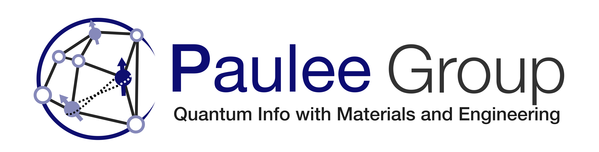

<!-- _class: title -->
<!-- _paginate: false -->
<!-- _footer: '' -->

Paulee Group · Center for Quantum Technology, KIST

# Quantum Signal Processing for Hyperfine-Conditioned Control

Engineering the operations to the detuning

Donghun Jung
2026-10-27 · Lab Meeting

