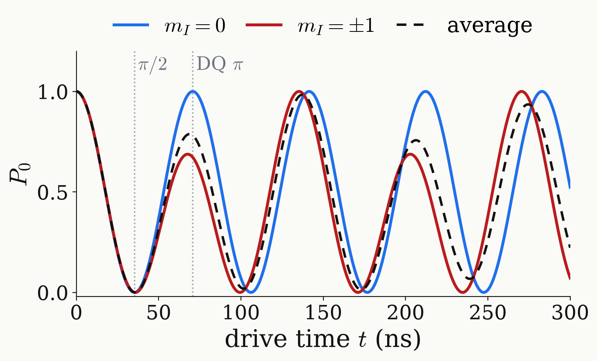
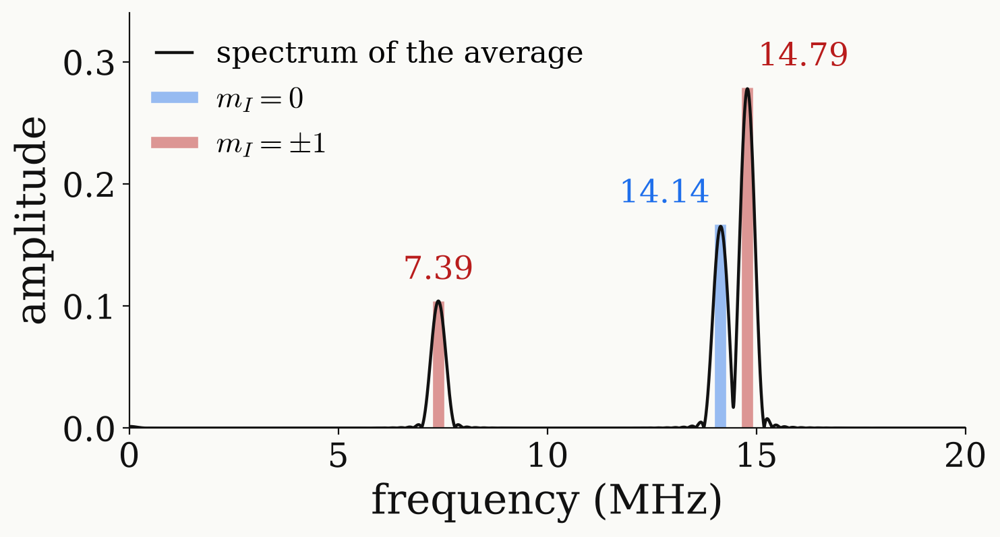

<!-- _class: tight -->

# Intro DQ nutation

The $\ket{0}$ population oscillates differently in each manifold: one line on resonance, two off resonance.

<figure class="figure">

</figure>

$$
P_0^{(m)}(t)=\Big[\frac{\Delta_m^2}{\Omega_m'^2}+\frac{\Omega_{DQ}^2}{\Omega_m'^2}\cos\Omega_m't\Big]^2,\quad \Omega_m'=\sqrt{\Omega_{DQ}^2+\Delta_m^2}
$$

<figure class="figure">

</figure>

$$
P_0^{(m)}=c_m+\frac{2\Delta_m^2\Omega_{DQ}^2}{\Omega_m'^4}\cos\Omega_m't+\frac{\Omega_{DQ}^4}{2\Omega_m'^4}\cos2\Omega_m't
$$

- On resonance $P_0=\cos^2\Omega_{DQ}t$: a single line at $2\Omega_{DQ}$.
- Off resonance $q<1$: $P_0$ returns only to $0.69$ at the DQ $\pi$ time, and a line at $\Omega_m'$ appears.
