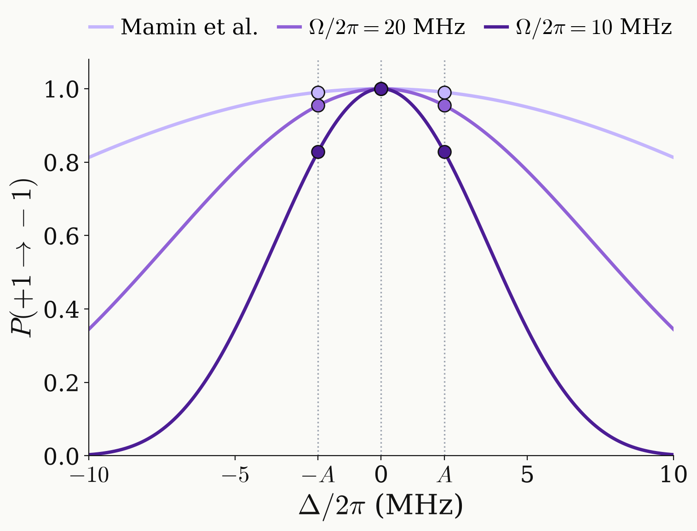

<!-- _class: dense -->

# Intro Single-pulse error

One rectangular DQ $\pi$ pulse misses the outer hyperfine manifolds.

<figure class="figure">

</figure>

$$
q=1-\eta_m^2+O(\eta^4),\qquad 1-P_{-1}\ \approx\ \tfrac43\,\eta_A^2
$$

with $\eta_m=\Delta_m/\Omega_{DQ}$ and $\Omega=\sqrt2\,\Omega_{DQ}$.

| drive | $\eta_A$ | $1-P_{-1}$ | $\pi/2$ phase |
|---|---|---|---|
| Mamin et al. | 0.069 | $6.3\times10^{-3}$ | $\pm7.9^\circ$ |
| $\Omega/2\pi=20$ MHz | 0.153 | $3.0\times10^{-2}$ | $\pm17.5^\circ$ |
| $\Omega/2\pi=10$ MHz | 0.305 | $0.115$ | $\pm34.9^\circ$ |

- The $\pi$ pulse leaves population in $\ket{0}$.
- The $\pi/2$ pulse fails through its phase.

**Phase coherence needs one common $Q^2$:** $\;Q(\Delta_m)=s_m\,e^{i\chi}$ with signs $s_m=\pm1$ and one phase $\chi$.

