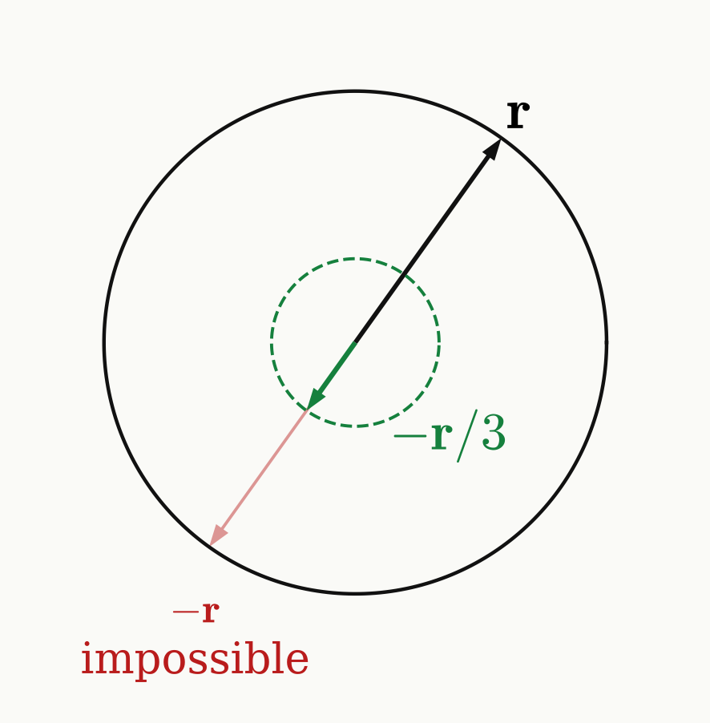

<!-- _class: tight -->

# Intro Universal NOT

The universal NOT flips every qubit state to its orthogonal state.

**Ideal:** $\ket{\psi}\mapsto\ket{\psi^\perp}$ for every $\ket\psi$, i.e. $\mathbf r\mapsto-\mathbf r$ on the Bloch sphere.

- Inverting every Bloch vector is a point reflection: antiunitary, so no physical operation does it.

**Optimal:** the best channel for all inputs at once,

$$
\rho\ \mapsto\ \frac13\sum_{i=x,y,z}\sigma_i\,\rho\,\sigma_i=\frac{2\,\mathbb 1-\rho}{3},\qquad \mathbf r\mapsto-\frac{\mathbf r}{3},\qquad F=\frac23 .
$$

- Three $\pi$ rotations about orthogonal axes, applied at random with equal weights.
- The unpolarised ¹⁴N supplies that random choice: one rotation per hyperfine line.

<figure class="figure">

</figure>

Bužek, Hillery, Werner, PRA 60, R2626 (1999); De Martini, Bužek, Sciarrino, Sias, Nature 419, 815 (2002)

