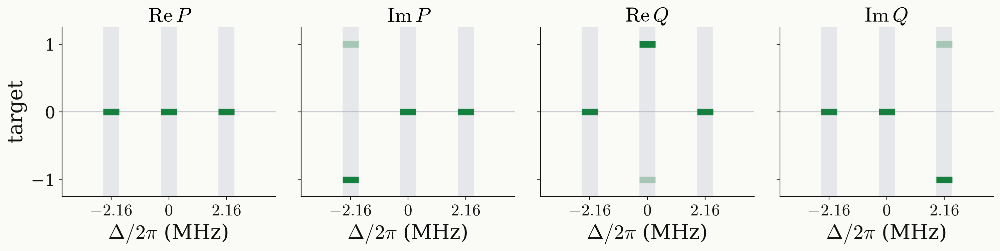

<!-- _class: tight -->

# Strategy Universal NOT: target function

The target fixes $P$ and $Q$ on the three bands $\Delta_m\pm3\sigma$ and leaves them free in between.

<figure class="figure">

</figure>

| $m_I$ | $\Delta_m/2\pi$ | gate | $P$ | $Q$ |
|---|---|---|---|---|
| $+1$ | $-2.16$ MHz | $R_z(\pi)=-iZ$ | $-i$ | $0$ |
| $0$ | $0$ | $R_y(\pi)=-iY$ | $0$ | $1$ |
| $-1$ | $+2.16$ MHz | $R_x(\pi)=-iX$ | $0$ | $-i$ |

$$
F_m=\frac{\lvert\mathrm{Tr}\,T_m^\dagger u\rvert^2+2}{6}
$$

- Light bars show $-T_m$, which is the same gate.
- Each band has the rms ¹³C width $\sigma/2\pi=0.1$ MHz.

