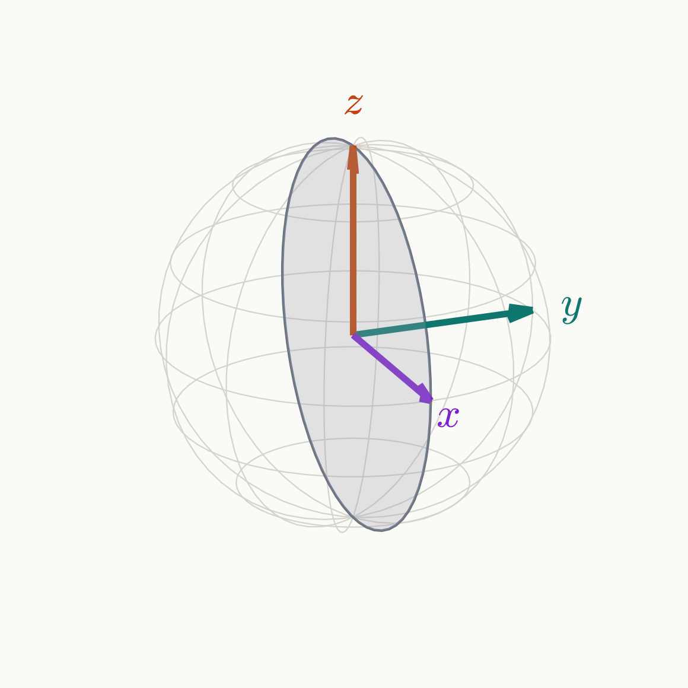

<!-- _class: tight -->

# Method Universal NOT: pulse phases

Two symmetries rule out the simplest sequences, so the pulses carry phases $\varphi_k$ and the sequence is arbitrary.

### Pulses about $\pm x$: mirror symmetry

$$
X\,h(\Delta)\,X=h(-\Delta)\quad\Longrightarrow\quad u(-\Delta)=X\,u(\Delta)\,X,\qquad u(0)=R_x\Big(\sum_k\beta_k\Big)
$$

- $R_z(\pi)$ on $m_I=+1$ forces $XR_z(\pi)X=-R_z(\pi)$, the same gate, on $m_I=-1$, and $m_I=0$ gets an $x$ rotation.

### Symmetric QSP: palindromic $(\beta_k,\varphi_k)$, with $\varphi\to-\varphi$

$$
R_\varphi(\beta)^T=R_{-\varphi}(\beta)\ \Longrightarrow\ u^T=u\ \Longrightarrow\ Q=-Q^*,\qquad Q=n_y-i\,n_x\ \Longrightarrow\ n_y=0
$$

- All three axes would lie in the $xz$ plane; orthogonal axes cannot.

<figure class="figure">

</figure>

Symmetric QSP: Dong, Meng, Whaley, Lin, PRA 103, 042419 (2021); Wang, Dong, Lin, Quantum 6, 850 (2022)

