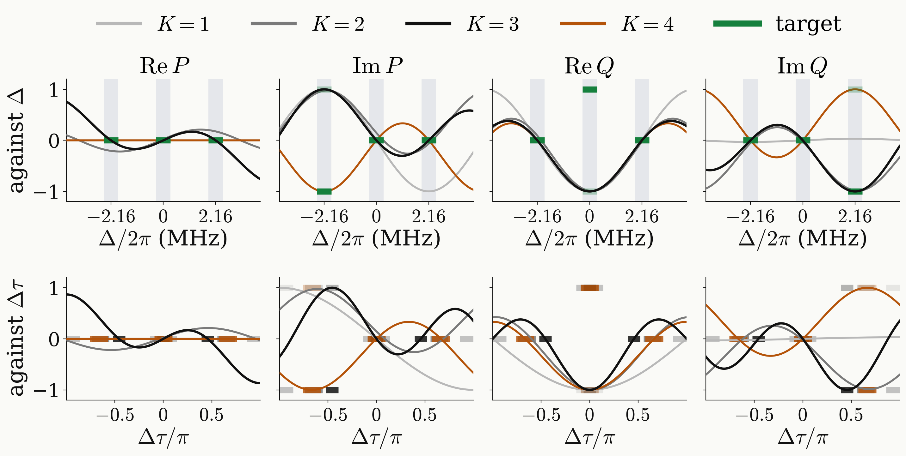

<!-- _class: tight -->

# Strategy Universal NOT: proper $K$

Counting conditions against parameters gives the degree; the response reaches all three targets from $K=3$ on.

$$
3\times3\ \text{conditions}\ \le\ 2(K+1)+1\ \ (\beta_k,\varphi_k,\tau)\ \Longrightarrow\ K=3;\qquad \text{fixed}\ \tau_{\rm sep}:\ 9\le2(K+1)\ \Longrightarrow\ K=4
$$

<figure class="figure">

</figure>

<figure class="figure">

<video src="media/ch3-unot-k-ladder.mp4" poster="media/ch3-unot-k-ladder.png" width="545" controls autoplay loop muted playsinline preload="none"></video>

</figure>

- $K=1$ and $2$ leave $1-F=0.22$ and $2.8\times10^{-2}$.
- $K=3$ is exact at $\tau=105.9$ ns.

