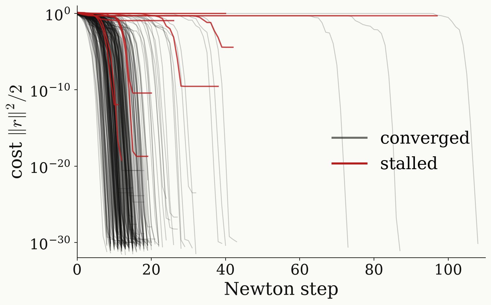
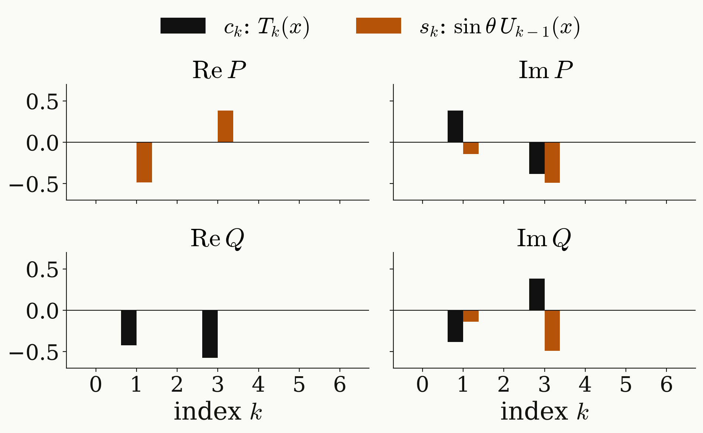

<!-- _class: tight -->

# Method Universal NOT: Newton solver

Damped Newton iteration solves the nine equations $r(\mathbf p)=0$ from random starts, with an exact Jacobian.

$$
\mathbf p\ \leftarrow\ \mathbf p-\big(J^TJ+\lambda\,\mathbb 1\big)^{-1}J^T r,\qquad\quad \frac{\partial u}{\partial p_k}=U_N\cdots U_{k+1}\,\frac{\partial U_k}{\partial p_k}\,U_{k-1}\cdots U_1
$$

<figure class="figure">

</figure>

- Most starts converge in about 20 steps; a few stall.

<figure class="figure">

</figure>

- Only odd $k\le3$ appear, as degree $3$ requires.

Newton iteration for symmetric QSP: Dong, Lin, Ni, Wang, SIAM J. Sci. Comput. 46, A2951 (2024)

