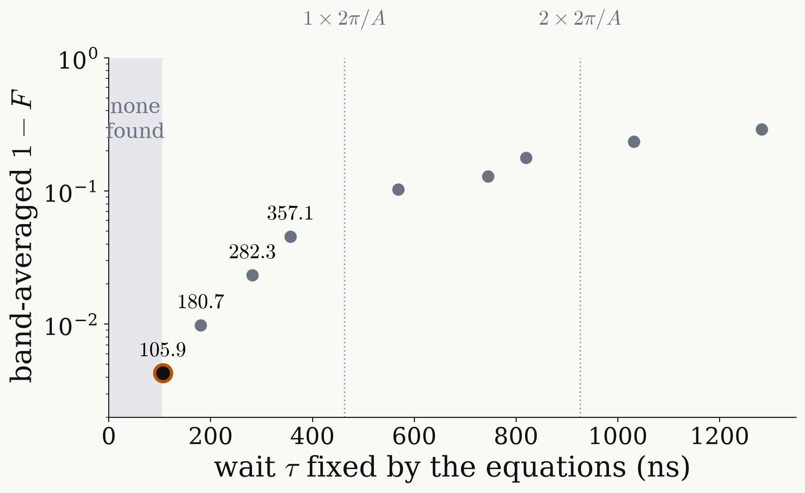

<!-- _class: tight -->

# Results Universal NOT: why $\tau=105.9$ ns

$\tau$ is not tuned: with nine equations for nine unknowns it is an output, and $105.9$ ns is the shortest root.

$$
r(\beta_1..\beta_4,\ \varphi_1..\varphi_4,\ \tau)=0:\quad 9\ \text{equations},\ 9\ \text{unknowns}\ \Longrightarrow\ \text{isolated roots}\quad \tau\in\{105.9,\ 180.7,\ 282.3,\ 357.1\}\ \text{ns}+n\,\tfrac{2\pi}{A}
$$

<figure class="figure">

</figure>

- Every root is exact on the three line centres; only the ¹³C band error differs.
- A ¹³C shift $\delta$ moves each line by $\delta\tau$ on the circle $e^{i\Delta\tau}$, so the band error grows with $\tau$.
- The shortest root wins: $4.3\times10^{-3}$, against $9.8\times10^{-3}$ at $180.7$ ns.
- Roots pair up as $\tau$ and $2\pi/A-\tau$ ($105.9+357.1=463.0$ ns).

