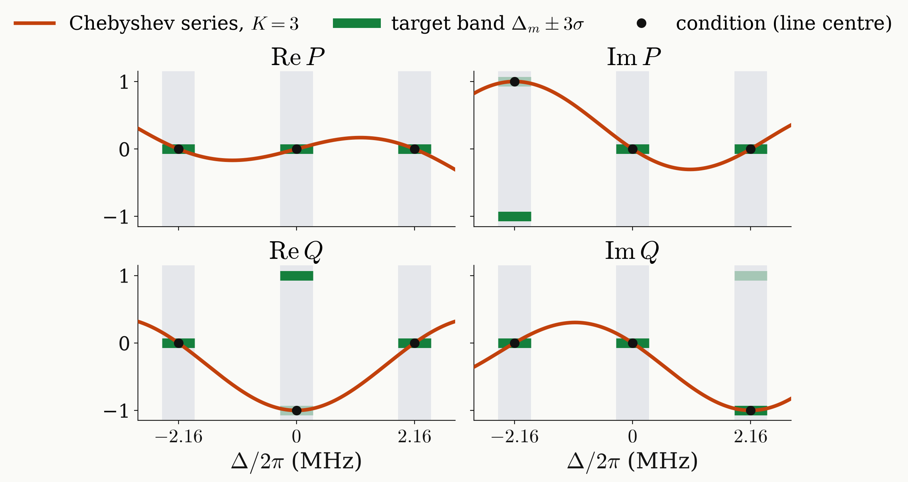

<!-- _class: tight -->

# Results Universal NOT: Chebyshev decomposition

The $K=3$ design is a degree-3 Chebyshev series; it meets the target at the three line centres, not across the bands.

$$
\mathrm{Re}\,P,\ \mathrm{Im}\,P,\ \mathrm{Re}\,Q,\ \mathrm{Im}\,Q=\sum_k\big[c_k\,T_k(x)+s_k\sin\theta\,U_{k-1}(x)\big],\qquad x=\cos\theta,\ \ T_k(x)=\cos k\theta
$$

<figure class="figure">

</figure>

<figure class="figure">

</figure>

- Only odd $k\le3$: degree and parity $3$.
- Exact at the centres; across the bands $1-F=4.3\times10^{-3}$.

