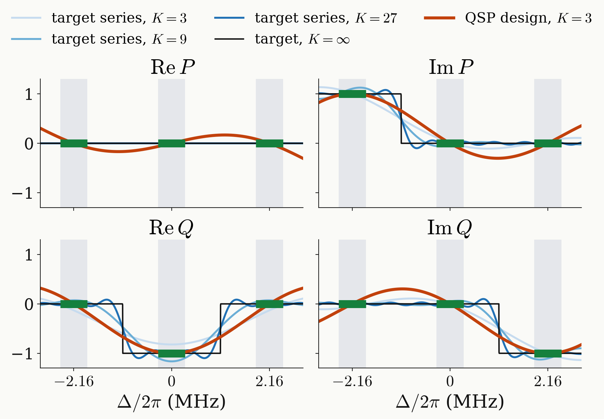
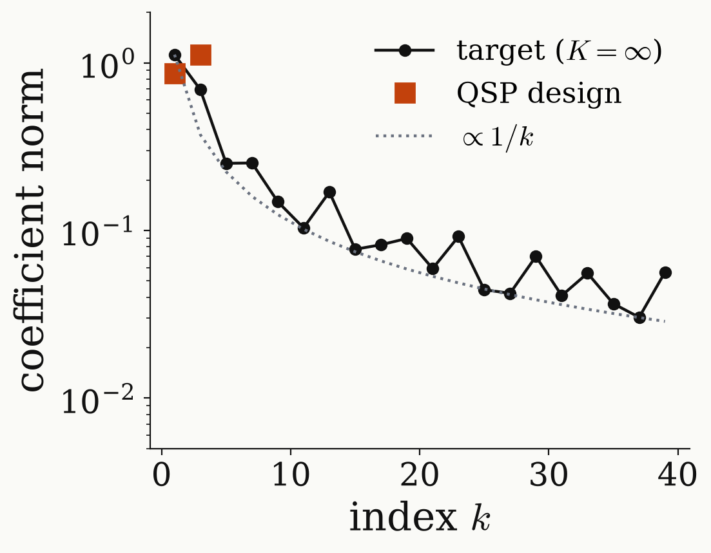

<!-- _class: tight -->

# Results Universal NOT: target against design

A completed band target needs every odd $k$; the QSP design is not its truncation.

<figure class="figure">

</figure>

<figure class="figure">

</figure>

- Completed with steps between the lines (one choice), the target has every odd $k$, decaying as $1/k$.
- Its truncations overshoot and break unitarity: $\lvert P\rvert^2+\lvert Q\rvert^2$ up to $1.36$.
- The design uses $k\le3$, stays unitary, and is exact at the line centres.

