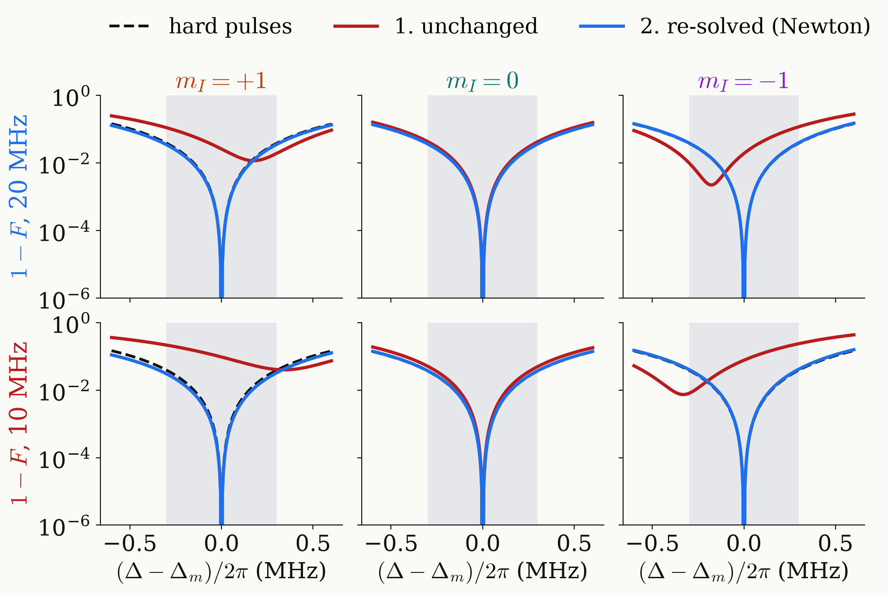

<!-- _class: tight -->

# Results Universal NOT: finite-pulse results

Unchanged, the dip leaves the centre of the $m_I=\pm1$ lines; re-solving puts it back.

<figure class="figure">

</figure>

| band $1-F$ | 20 MHz | 10 MHz |
|---|---|---|
| 1. unchanged | $2.0\times10^{-2}$ | $6.2\times10^{-2}$ |
| 2. re-solved | $4.2\times10^{-3}$ | $4.1\times10^{-3}$ |

- Re-solved: $\tau=97.0$ / $86.8$ ns, $T=334$ / $351$ ns, exact on all three lines again.

