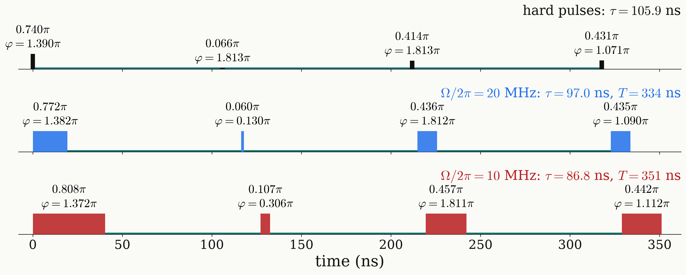

<!-- _class: tight -->

# Results Universal NOT: pulse sequence

The finite-pulse designs stay close to the hard design, with larger main angles and a shorter $\tau$.

<figure class="figure">

</figure>

- The refined sequences last $T=334$ ns at 20 MHz and $351$ ns at 10 MHz.
- The second pulse is short: $0.060\pi$ lasts $1.5$ ns at 20 MHz, comparable to typical rise times.
