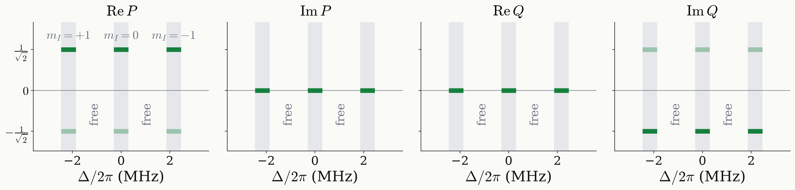

<!-- _class: tight -->

# Strategy DQ preparation: target function

The target is a state, $\lvert0\rangle\to\tfrac{1}{\sqrt2}\big(\lvert{+1}\rangle+\lvert{-1}\rangle\big)$, with the same relative phase in all three manifolds.

$$
D^1(u)\lvert0\rangle=\big(-\sqrt2\,PQ^*,\ \lvert P\rvert^2-\lvert Q\rvert^2,\ \sqrt2\,P^*Q\big),\qquad f=4\,\big[\mathrm{Im}\,(P^*Q)\big]^2
$$

<figure class="figure">

</figure>

- $f=1$ if and only if $\lvert P\rvert^2=\tfrac12$ and $\mathrm{Re}\,(P^*Q)=0$; the second condition is the phase coherence.
- The bars show the palindromic form $P=\pm\tfrac{1}{\sqrt2}$, $Q=\pm\tfrac{i}{\sqrt2}$; $u\to-u$ and $u\to u\,R_z(\gamma)$ change nothing.
