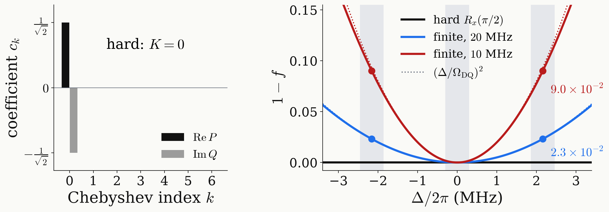

<!-- _class: tight -->

# Method DQ preparation: finite pulses

A hard $\pi/2$ pulse prepares the target at every $\Delta$; a finite one leaves a DQ phase error.

$$
U_{\rm finite}(\tfrac{\pi}{2})\simeq R_z(\Delta t_e)\,R_x(\tfrac{\pi}{2})\,R_z(\Delta t_e)\ \Longrightarrow\ \tfrac{1}{\sqrt2}\big(e^{-i\Delta t_e}\lvert{+1}\rangle+e^{i\Delta t_e}\lvert{-1}\rangle\big),\qquad t_e=\frac{1}{\Omega_{\rm DQ}}
$$

<figure class="figure">

</figure>

<figure class="figure">

<video src="media/ch3-prep-bloch.mp4" poster="media/ch3-prep-bloch.png" width="500" controls autoplay loop muted playsinline preload="none"></video>

</figure>

- With hard pulses the target is a constant: one Chebyshev coefficient, $K=0$.
- One finite pulse gives $1-f\simeq(\Delta/\Omega_{\rm DQ})^2$: $2.3\times10^{-2}$ (20 MHz) and $9.0\times10^{-2}$ (10 MHz) on $m_I=\pm1$.
- No wait can undo it (it would need negative time), so the pulses must.
