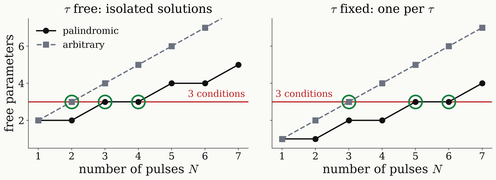

<!-- _class: tight -->

# Method DQ preparation: exact structure

Finite pulses about $\pm x$ have three exact properties, which leave three conditions to solve.

1. Mirror symmetry: $u(-\Delta)=X\,u(\Delta)\,X$, so only $\Delta=0$ and $\Delta=A$ need fitting.
2. Line centre: $u(0)=R_x\big(\sum_k\beta_k\big)$, so $\sum_k\beta_k\equiv\pi/2\pmod{\pi}$.
3. Palindromic: $u^T=u\Rightarrow Q=-i\,r$ with $r$ real, so coherence becomes $\mathrm{Im}\,P(A)=0$.

<figure class="figure">

</figure>

- Coherence costs no extra condition: the target is a state, so both classes need 3.
