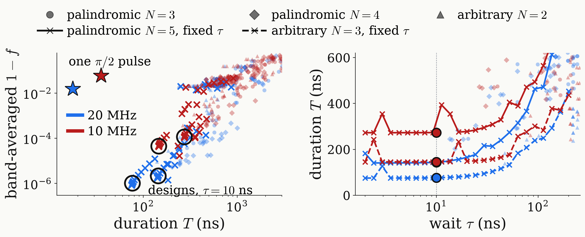
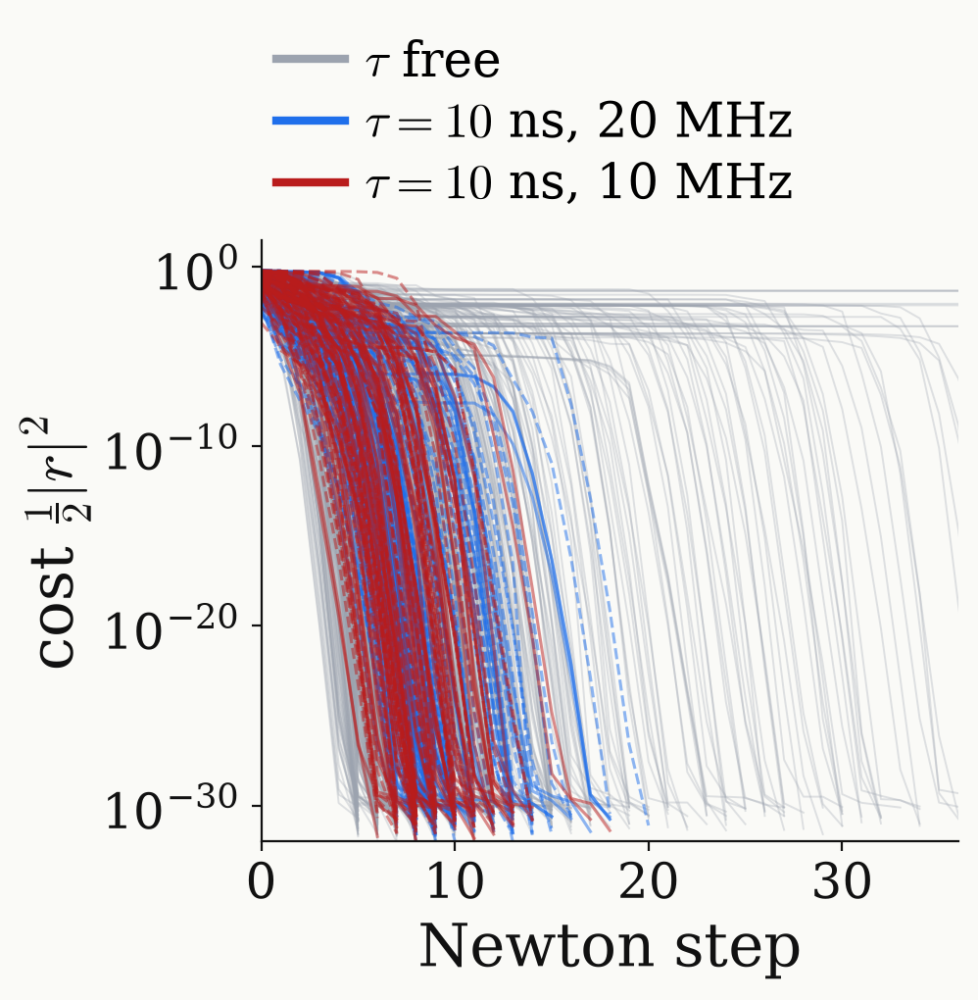

<!-- _class: tight -->

# Strategy DQ preparation: proper $\tau$

One common target means no overlap rule; $\tau$ is chosen for a short sequence with a small band error.

<figure class="figure">

</figure>

<figure class="figure">

</figure>

- For short $\tau$ the arbitrary family is shorter than every isolated solution, and both families have a smaller band error.
- Below $\tau\approx10$ ns the duration hardly depends on $\tau$ (composite pulses as $\tau\to0$), so we take $\tau=10$ ns.
- At fixed $\tau$, damped Newton converges from random starts in 6 to 20 steps.
