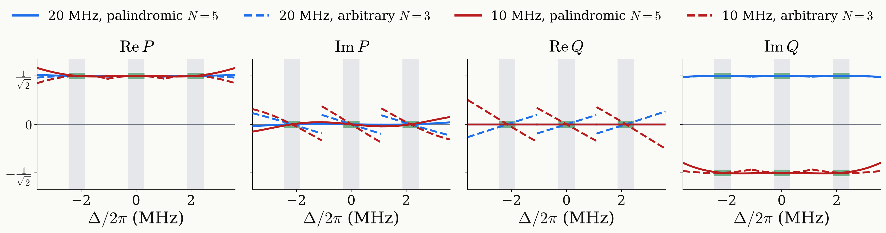
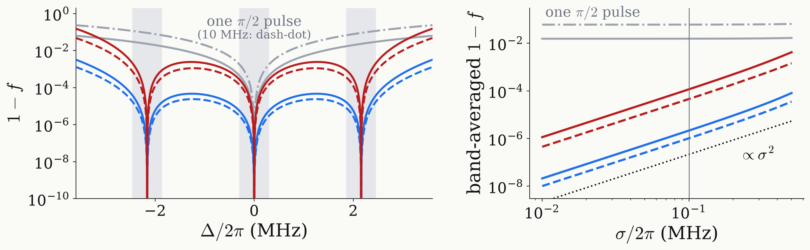

<!-- _class: tight -->

# Results DQ preparation: response

The four designs prepare the target exactly at the three line centres, with the same relative phase.

<figure class="figure">

</figure>

<figure class="figure">

</figure>

- The global phase of each manifold is fixed at its line centre.
- The relative phase $\arg(c_{-1}/c_{+1})$ is zero at all three centres.
- The band error grows as $\sigma^2$: exact at the centres, not flat.

