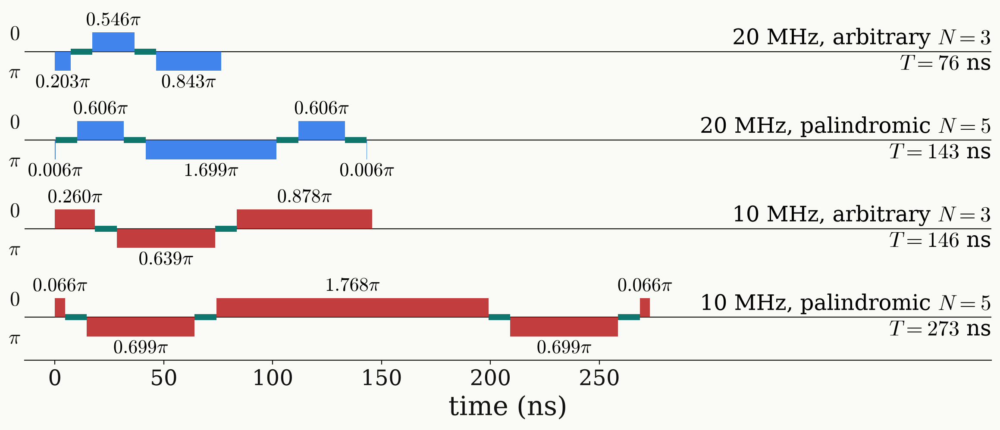

<!-- _class: tight -->

# Results DQ preparation: pulse sequence

At $\tau=10$ ns the arbitrary sequence is the better one: three pulses, half as long.

<figure class="figure">

</figure>

| $\Omega/2\pi$ | sequence | $\beta_k/\pi$ (negative: phase $\pi$) | $T$ | band $1-f$ |
|---|---|---|---|---|
| 20 MHz | arbitrary $N=3$ | ${-0.203},\ 0.546,\ {-0.843}$ | 76 ns | $1.0\times10^{-6}$ |
| 20 MHz | palindromic $N=5$ | ${-0.006},\ 0.606,\ {-1.699},\ 0.606,\ {-0.006}$ | 143 ns | $2.2\times10^{-6}$ |
| 10 MHz | arbitrary $N=3$ | $0.260,\ {-0.639},\ 0.878$ | 146 ns | $4.6\times10^{-5}$ |
| 10 MHz | palindromic $N=5$ | $0.066,\ {-0.699},\ 1.768,\ {-0.699},\ 0.066$ | 273 ns | $1.2\times10^{-4}$ |
