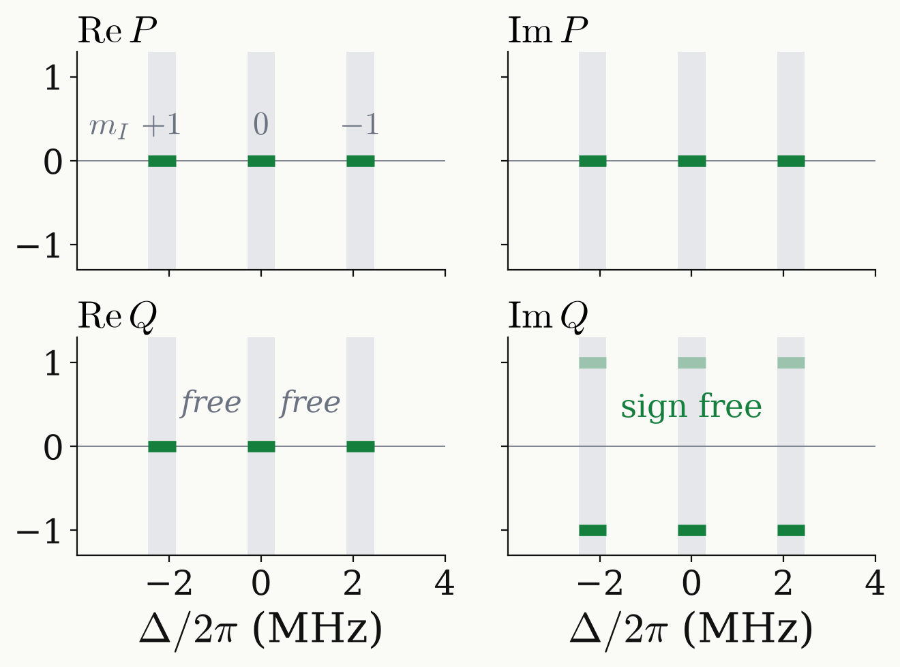

<!-- _class: tight -->

# Strategy DQ $\pi$ pulse: target function

The DQ $\pi$ pulse swaps $\ket{{+1}}$ and $\ket{{-1}}$ with the same spin-1 unitary on all three lines.

<figure class="figure">

</figure>

$$
P=0:\qquad D^1(u)=\begin{pmatrix}0&0&Q^{*2}\\0&-1&0\\Q^2&0&0\end{pmatrix}
$$

The same on every line iff $Q_m^2=Q_0^2$: target $P=0$, $Q=\mp i$ on the bands.

$$
F=\frac{(4t^2-1)^2+3}{12},\qquad t=\lvert\mathrm{Im}\,Q\rvert
$$
$$
1-F\simeq2\big(\lvert P\rvert^2+(\mathrm{Re}\,Q)^2\big)
$$

- A common $U$ has $US_zU^\dagger=-S_z$, so $e^{-i\Delta S_zt}\,U\,e^{-i\Delta S_zt}=U$ for every $\Delta$.
- A train of these pulses refocuses the hyperfine and static ¹³C shifts.

