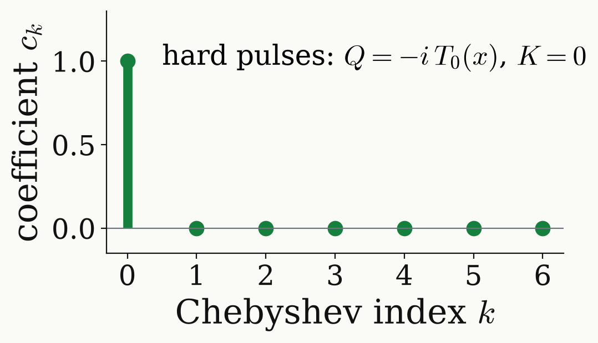
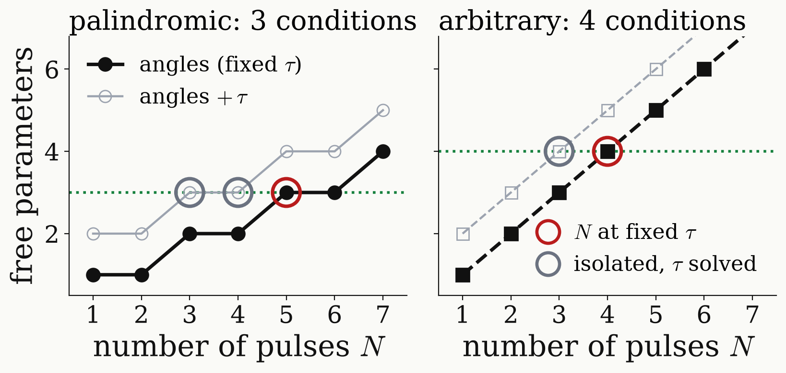

<!-- _class: tight -->

# Method DQ $\pi$ pulse: finite pulses

Hard pulses need one coefficient; for finite pulses, counting conditions gives the number of pulses.

<figure class="figure">

</figure>

$$
U_{\rm finite}(\pi)=R_x(\pi)\Big[1-i\,\frac{\Delta}{\Omega_{\rm DQ}}\,Y\Big]+O(\Delta^2)
$$

- No free evolution undoes a $y$ rotation: $1-F=4.6\times10^{-2}$ (20 MHz) and $0.17$ (10 MHz) on $m_I=\pm1$.

<figure class="figure">

</figure>

- The conditions at the centres are $\sum\beta\equiv\pi$ and $\mathrm{Re}\,P(A)=\mathrm{Im}\,P(A)=0$, plus $\mathrm{Re}\,Q(A)=0$ for arbitrary sequences.
- At fixed $\tau$ this needs $N=5$ palindromic or $N=4$ arbitrary pulses.

