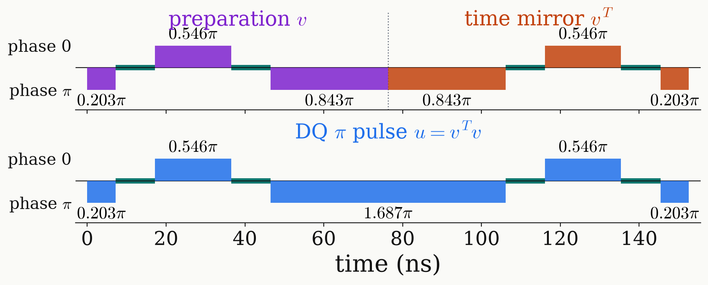

<!-- _class: tight -->

# Method DQ $\pi$ pulse: time mirror

A preparation followed by its time mirror is a phase-coherent DQ $\pi$ pulse.

$$
v=\begin{pmatrix}p&-q^*\\q&p^*\end{pmatrix}\ \xrightarrow{\ \text{reversed order}\ }\ v^T=\begin{pmatrix}p&q\\-q^*&p^*\end{pmatrix},\qquad u=v^Tv:\quad P=p^2+q^2=0\ \ \text{since}\ q=\pm ip
$$

<figure class="figure">

</figure>

<figure class="figure">

<video src="media/ch3-pi-mirror.mp4" poster="media/ch3-pi-mirror.png" width="510" controls autoplay loop muted playsinline preload="none"></video>

</figure>

- At 20 MHz the mirrored preparation is the symmetric $\pi$ design, $153$ ns, twice the preparation.
- At 10 MHz it is the symmetric design with every pulse phase shifted by $\pi$, an equivalent gate.
