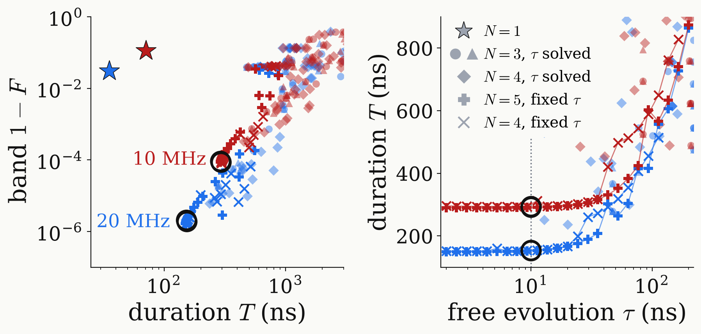
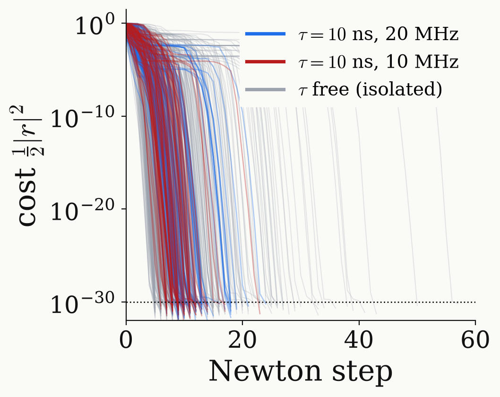

<!-- _class: tight -->

# Strategy DQ $\pi$ pulse: proper $\tau$

At short $\tau$ the fixed-$\tau$ sequences are the shortest and most accurate; Newton iteration finds them in about ten steps.

<figure class="figure">

</figure>

<figure class="figure">

</figure>

- Isolated solutions fix $\tau$ themselves and are longer: palindromic $N=4$ at 20 MHz takes $236$ ns ($\tau=20.1$ ns).
- Below $\tau\approx20$ ns the duration $T$ hardly depends on $\tau$; we keep $\tau=10$ ns.
