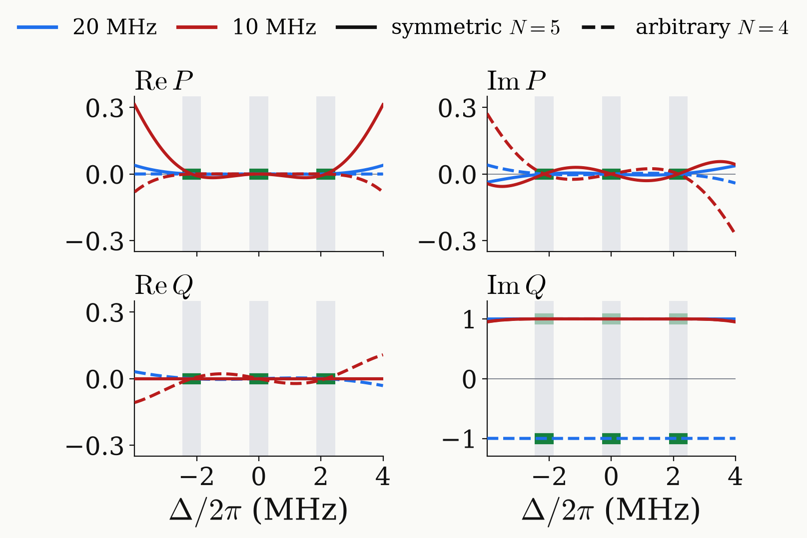

<!-- _class: tight -->

# Results DQ $\pi$ pulse: response

On the three lines every design meets the target; between and beyond them the response is free.

<figure class="figure">

</figure>

- The symmetric designs have $\mathrm{Re}\,Q\equiv0$ at every $\Delta$.
- The arbitrary designs have $\mathrm{Re}\,Q=0$ only at the line centres.
- Away from the lines $P$ grows, faster at 10 MHz.

