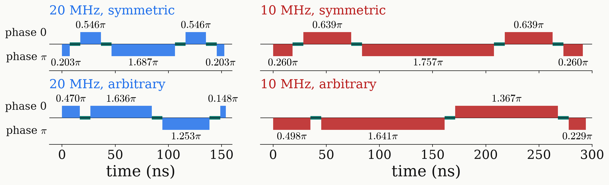

<!-- _class: tight -->

# Results DQ $\pi$ pulse: pulse sequence

Four or five full-amplitude pulses with $\tau=10$ ns invert all three lines with one phase.

<figure class="figure">

</figure>

| $\Omega/2\pi$ | design | $\beta_k/\pi$ (negative: phase $\pi$) | $T$ | band $1-F$ |
|---|---|---|:-:|:-:|
| 20 MHz | symmetric, $N=5$ | $-0.203,\ 0.546,\ {-}1.687,\ 0.546,\ {-}0.203$ | 153 ns | $2.1\times10^{-6}$ |
| 20 MHz | arbitrary, $N=4$ | $0.470,\ 1.636,\ {-}1.253,\ 0.148$ | 154 ns | $1.9\times10^{-6}$ |
| 10 MHz | symmetric, $N=5$ | $-0.260,\ 0.639,\ {-}1.757,\ 0.639,\ {-}0.260$ | 291 ns | $9.1\times10^{-5}$ |
| 10 MHz | arbitrary, $N=4$ | $-0.498,\ {-}1.641,\ 1.367,\ {-}0.229$ | 294 ns | $8.6\times10^{-5}$ |
