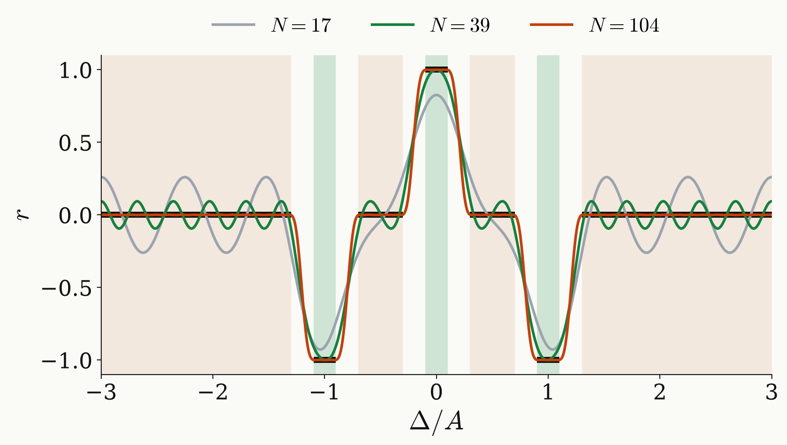

<!-- _class: dense -->

# Backup Wide stopband

A stopband over $\lvert\Delta\rvert\le3A$ needs 104 pulses for $E=10^{-3}$.

<figure class="figure">

</figure>

$$
\tau=\frac{2\pi}{6A}
$$

| $E$ | $N$ | $K\tau$ |
|---|---|---|
| $0.1$ | 36 | 2.7 $\mu$s |
| $10^{-2}$ | 68 | 5.2 $\mu$s |
| $10^{-3}$ | 104 | 7.9 $\mu$s |

- At $\tau=2\pi/3A$ the smallest degree is $K=39$; $K\tau$ stays between $5.9$ and $6.8\,\mu\text{s}$ for every $\tau$.
- Smoothed step series in $w=e^{i\Delta\tau}$: degree 48 instead of 21 at $2\pi/3A$, 109 instead of 41 at $2\pi/6A$.
