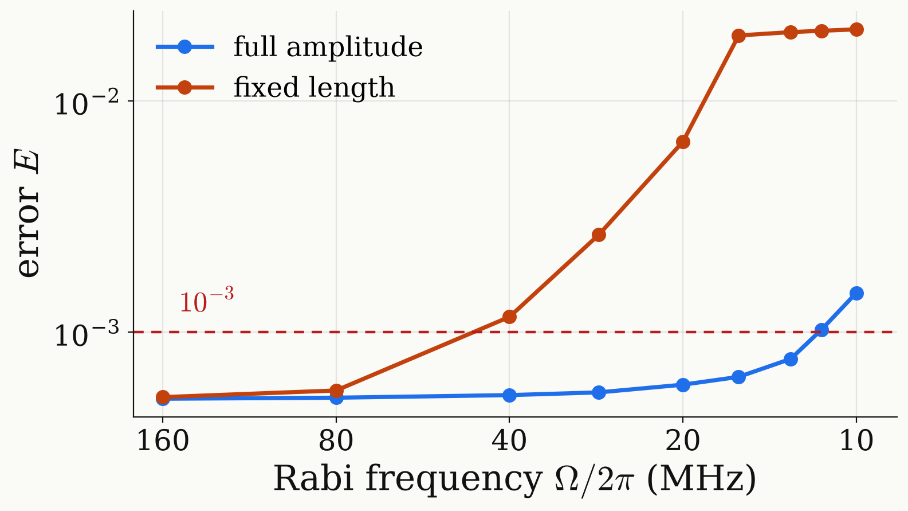

<!-- _class: dense -->

# Backup Continuation in the Rabi frequency

The error grows smoothly as the drive weakens.

<figure class="figure">

</figure>

| $10$ MHz, symmetric | $N=14$ ($2\pi/A$) | $N=27$ ($\pi/A$) | $N=40$ ($2\pi/3A$) |
|---|---|---|---|
| full amplitude | $1.5\times10^{-3}$ (5.8 $\mu$s) | $5.2\times10^{-4}$ (5.9 $\mu$s) | $5.2\times10^{-4}$ (5.9 $\mu$s) |
| fixed length | $1.4\times10^{-2}$ (5.7 $\mu$s) | $7.7\times10^{-4}$ (5.8 $\mu$s) | $2.6\times10^{-4}$ (6.4 $\mu$s) |
