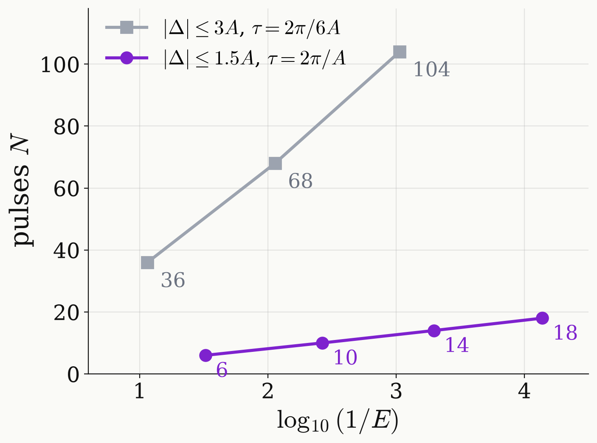

<!-- _class: dense -->

# Backup Degree scaling

A step across a gap needs degree $K\propto\ln(1/\varepsilon)/\Delta\theta$.

<figure class="figure">

</figure>

$$
K\simeq c\,\frac{\ln(1/\varepsilon)}{\Delta\theta}
$$

- The gap $\Delta\theta$ is the transition band, $0.2A$ in $\Delta$: $0.2\pi$ at $\tau=2\pi/A$, $0.2\pi/6$ at $\tau=2\pi/6A$.
- Both targets need a number of pulses linear in $\ln(1/E)$.
- $E_N$ falls by 7 to 8 per four pulses.

Low and Chuang (2017); Martyn et al. (2021)

